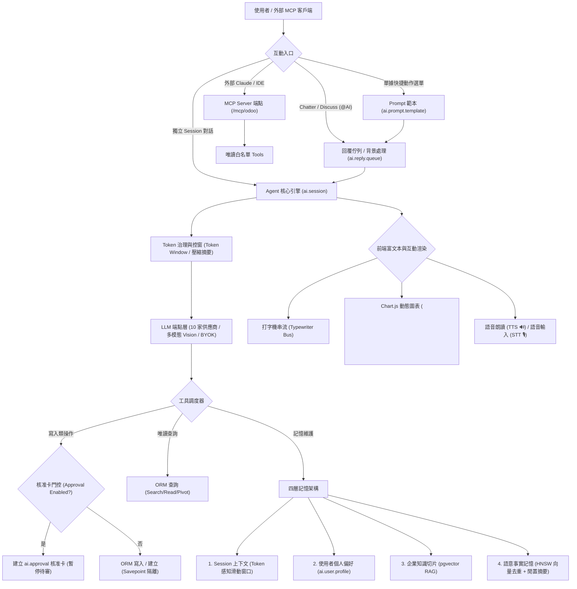

# Odoo AI Agent

> **Odoo 18 原生 AI Agent 商業專有框架 (OPL-1)**  
> 具備多模態視覺 (Vision API) 結構化辨識、單據快捷動作範本、Chart.js 動態圖表、原生語音聽寫/朗讀、Token 治理與在途壓縮、四層持久記憶、模型白名單 ORM Tool Calling、雙向 MCP（Client & Server）、人機協同寫入核准卡、Chatter/Discuss 打字機串流與 Token 預算成本儀表板。  
> **零第三方 AI 框架依賴**：免除 LangChain、LlamaIndex、CrewAI 等重型包袱，核心推論與排程僅使用純 Python `requests` + 標準庫 + PostgreSQL `pgvector`。

> ### 💡 為什麼企業需要 Odoo AI Agent？（30 秒核心價值主張）
> 市面常見的 AI 整合多為「外掛式聊天視窗」，面臨**資料越權外洩**、**隨意篡改單據**、**Token 費用無底洞**以及**被單一雲端廠商綁定**四大致命風險。  
> **Odoo AI Agent** 是首個專為 Odoo 18 打造的**企業級受控 Agent 治理平台**：
> 1. **資料主權自主**：支援核心 Agent 全內網離線部署（Ollama / vLLM），ERP 業務資料推論全程不出境；外掛功能（雲端 Vision、雲端 Embedding、Web Search）為可選雲端能力，可一律改用本地模型或以停用旗標關閉。
> 2. **雙層安全與人機協同**：工具一律以「發問者本身的 Odoo ACL」執行，寫入操作自動觸發「管理員核准卡 (Human-in-the-Loop)」，杜絕 AI 越權改單。
> 3. **透明營運與成本治理**：Token-aware 動態滑動窗口與在途壓縮防爆窗，搭配每月 USD 預算硬上限，徹底杜絕帳單暴增。

---

## 📑 目錄 / Table of Contents

- [繁體中文說明 (Traditional Chinese)](#-繁體中文說明)
  - [1. 核心設計理念與系統架構](#1-核心設計理念與系統架構)
  - [2. 十四大核心功能詳解](#2-十四大核心功能詳解)
    - [2.1 LLM 端點層 (BYOK 多供應商適配，10 家預設與維度控制)](#21-llm-端點層-byok-多供應商適配-10-家預設與維度控制)
    - [2.2 多模態視覺辨識與單據欄位抽取 (Multimodal Vision API)](#22-多模態視覺辨識與單據欄位抽取-multimodal-vision-api)
    - [2.3 Tool Calling 與智能關聯 ORM 工具箱 (Smart Coercion Engine)](#23-tool-calling-與智能關聯-orm-工具箱-smart-coercion-engine)
    - [2.4 人機協同寫入核准卡與 Chatter 雙向連動 (Human-in-the-Loop Approval)](#24-人機協同寫入核准卡與-chatter-雙向連動-human-in-the-loop-approval)
    - [2.5 雙向 MCP 整合 (Model Context Protocol)](#25-雙向-mcp-整合-model-context-protocol)
    - [2.6 Token 治理與在途壓縮控窗 (Token Governance & In-Flight Compression)](#26-token-治理與在途壓縮控窗-token-governance--in-flight-compression)
    - [2.7 四層持久記憶架構 (Four-Layer Memory)](#27-四層持久記憶架構-four-layer-memory)
    - [2.8 企業 RAG 知識庫 (Enterprise Knowledge & pgvector)](#28-企業-rag-知識庫-enterprise-knowledge--pgvector)
    - [2.9 Chatter 與 Discuss 全渠道互動與單據脈絡感知](#29-chatter-與-discuss-全渠道互動與單據脈絡感知)
    - [2.10 單據快捷動作與 Prompt 範本庫 (Prompt Templates & Quick Actions)](#210-單據快捷動作與-prompt-範本庫-prompt-templates--quick-actions)
    - [2.11 Text-to-Chart 動態圖表視覺化 (Chart.js Native Rendering)](#211-text-to-chart-動態圖表視覺化-chartjs-native-rendering)
    - [2.12 原生 Web Speech 語音聽寫 (STT) 與語音朗讀 (TTS)](#212-原生-web-speech-語音聽寫-stt-與語音朗讀-tts)
    - [2.13 自動化排程 AI 報告任務 (`ai.report.task`)](#213-自動化排程-ai-報告任務-aireporttask)
    - [2.14 Token 用量與成本儀表板及每月預算硬配額 (Usage & Cost Hard Quota)](#214-token-用量與成本儀表板及每月預算硬配額-usage--cost-hard-quota)
  - [3. 模組導航選單架構 (Reorganized Navigation)](#3-模組導航選單架構-reorganized-navigation)
  - [4. 安全威脅模型、權限治理與資料合規 (Security Threat Model & Compliance)](#4-安全威脅模型權限治理與資料合規-security-threat-model--compliance)
  - [5. 安裝與快速上手指南](#5-安裝與快速上手指南)
  - [6. 自動化測試與品質保證 (130/130 通過 & Eval Benchmark)](#6-自動化測試與品質保證-130130-通過--eval-benchmark)
  - [7. 商業專有授權與合約條款 (OPL-1 & Commercial Terms)](#7-商業專有授權與合約條款-opl-1--commercial-terms)
- [English Summary & Guide](#-english-summary--guide)
  - [Key Architecture & Highlights](#key-architecture--highlights)
  - [14 Core Features Breakdown](#14-core-features-breakdown)
  - [Navigation Structure](#navigation-structure)
  - [Quick Start](#quick-start)
  - [Automated Testing Suite (130/130 Passed & Eval Benchmark)](#automated-testing-suite-130130-passed--eval-benchmark)
  - [Commercial Licensing & Terms of Use (OPL-1)](#commercial-licensing--terms-of-use-opl-1)

---

# 🇹🇼 繁體中文說明

## 1. 核心設計理念與系統架構

傳統 ERP 導入大語言模型（LLM）常面臨四大痛點：**資料權限失控**、**缺乏長期業務記憶**、**過度依賴外部重型框架（LangChain 等）帶來的維護地獄**，以及**長對話 Token 暴增與費用失控**。

`odoo_ai_agent` 專為 Odoo 18 原生打造：
1. **零外部 SDK 依賴**：不安裝任何額外 AI SDK，全功能以 Python 標準庫與 `requests` 實現，輕量高效。
2. **安全第一的執行身分（Dual-layer Security）**：所有工具調用一律以「發問者本身的 Odoo ACL 與 Record Rules」執行，外加「Agent 模型技術名白名單」作為硬上限，杜絕越權。
3. **原生嵌入業務流**：AI 助理就是 Odoo 的一位虛擬員工，可在銷售單、發票、專案 Chatter 中直接 `@mention`，也能在 Discuss 頻道或獨立 Session 中互動。
4. **企業級 Token 治理**：Token-aware 動態滑動窗口、超長 Tool 輸出截斷與丟棄輪次在途壓縮，保障推論穩定性與成本透明度。

### 📊 為什麼選擇本模組？與 Odoo 原生官方 AI 之差異化比較

| 評估維度 | Odoo 18 原生/官方 AI (IAP / Discuss) | Odoo AI Agent (本模組專有架構) |
| :--- | :--- | :--- |
| **模型自主權 (BYOK)** | 通常綁定官方合作雲端或購買官方 IAP 點數 | **10 家自由切換**（OpenAI, Gemini, Claude, DeepSeek, Groq 等），可隨時更換最新模型 |
| **私有化與資料主權** | 依賴外網雲端服務，敏感資料需出境 | **核心 Agent 全內網離線支援**（Ollama, vLLM, llama.cpp），ERP 商業數據推論完全不出內網；外掛能力（雲端 Vision/Embedding/Web Search）可改用本地模型或停用 |
| **業務資料寫入控制** | 多數僅供文字生成/輔助摘要，缺乏完整 ORM 寫入門控 | **人機協同寫入核准卡 (Human-in-the-Loop)**，變更需主管審核並具備 Savepoint 事務保護 |
| **外部工具生態系** | 封閉於 Odoo 原生環境 | **雙向 MCP 整合**（可引入外部工具，亦可將 Odoo 唯讀工具暴露給 Claude / Cursor / IDE） |
| **成本透明與預算控制** | 官方點數消耗，難以精細控管各員工配額 | **逐 Session 換算真實 USD 成本**，支援使用者層級每月預算硬配額阻斷 |
| **長對話與記憶治理** | 單次對話記憶有限，易受上下文限制爆窗 | **四層持久記憶**（Profile/RAG/語意事實/閒置摘要）+ 在途 LLM 壓縮控窗 |



---

## 2. 十四大核心功能詳解

### 2.1 LLM 端點層 (BYOK 多供應商適配，10 家預設與維度控制)
- **10 家主流雲端與本地供應商預設（9 家官方模板 + 1 自訂 OpenAI 相容端點）**：
  - **Google Gemini**（預設 `gemini-2.5-flash`、`gemini-embedding-2`，Context Window 1M tokens）
  - **OpenAI**（預設 `gpt-4o-mini`、`text-embedding-3-small`，Context Window 128k）
  - **OpenRouter**（全球頂尖開源與商用模型一站式聚合存取，預設 `google/gemini-2.5-flash`，Context Window 1M）
  - **Anthropic Claude**（預設 `claude-sonnet-4-20250514` 原生 Messages API 格式適配，Context Window 200k）
  - **DeepSeek**（預設 `deepseek-chat` 高性價比推論，Context Window 128k）
  - **Groq**（預設 `llama-3.3-70b-versatile` 極速推論，Context Window 131k）
  - **Mistral AI**（預設 `mistral-small-latest`、`mistral-embed`，Context Window 128k）
  - **xAI (Grok)**（預設 `grok-2-latest`，Context Window 131k）
  - **Ollama (本機/區網)**（本地離線部署 `qwen2.5`、`qwen3-embedding`，Context Window 32k）
  - **自訂相容端點 (Custom)**（本地/私有部署 vLLM、LM Studio、llama.cpp 等任何相容 OpenAI 協定之端點）
  > *註：上述模型名稱均為建立時推薦之預設值，管理員於端點表單中可隨時依需求填入各大廠牌最新釋出之模型技術名稱。*
- **多協議智能轉換**：
  - **OpenAI Function Calling**：標準 Tool Calls 結構解析。
  - **Google Gemini generateContent**：自動合併多條系統提示為單一 `systemInstruction`、轉換 JSON Schema 為大寫型別（`STRING`、`OBJECT` 等）、完整回傳 `thoughtSignature`。
  - **Anthropic Messages API**：自動合併連續同角色訊息，精確映射 `tool_use` 與 `tool_result`。
- **Embedding 維度自適應控制**：
  - 支援 Matryoshka 向量維度自動裁剪與 L2 正規化（適用於支援 MRL 特性的模型如 OpenAI `text-embedding-3-*`；其他固定維度模型則保持原生輸出維度）。
  - 防禦性檢查：當模型回傳維度小於資料庫欄位定義時，主動拋出明確錯誤，避免 PostgreSQL pgvector 事務損壞。
- **一鍵連線測試與動態模型抓取**：
  - 表單內一鍵驗證 Chat 響應與 Embedding 向量維度。
  - 內建 **`action_fetch_models` 動態模型清單抓取**（支援 OpenAI 相容 `/models` 與 Google Gemini 模型端點，自動過濾語音/TTS 模型並區分 Chat / Embedding），搭配前端 OWL 搜尋式 **`model_combobox` 下拉元件**，可從抓回清單挑選或自由輸入最新模型名稱。

---

### 2.2 多模態視覺辨識與單據欄位抽取 (Multimodal Vision API)
- **視覺模型直讀（非傳統本地 OCR）**：
  - 本功能由雲端多模態大模型（GPT-4o、Gemini 2.5 Flash、Claude Sonnet 4）視覺 API 驅動，直接進行圖像語意理解與業務欄位抽取，免除伺服器安裝 Tesseract 傳統字元辨識引擎之相容性包袱。
  - 在單據 Chatter、Discuss 頻道或 Session 中上傳圖片（支援 `.png`、`.jpg`、`.jpeg`、`.webp`、`.gif`）。
  - 自動讀取二進制內容並轉換為標準 Base64 Data URL。
- **跨平台多模態注入**：
  - 為 OpenAI、Google Gemini、Anthropic Claude 模型自動組裝原生 `image_url` 訊息結構。
- **業務單據自動辨識與建立**：
  - 對使用者上傳的發票、收據、名片、商品照片，LLM 可直接精確解析欄位（單號、統編、金額、品項等），並結合 `odoo_create` 工具自動建單入庫。

---

### 2.3 Tool Calling 與智能關聯 ORM 工具箱 (Smart Coercion Engine)
- **內建 ORM 工具庫**：
  - `odoo_describe_model`：**模型結構與欄位探測（Schema Discovery）**。在執行查詢或建立記錄前動態探測欄位名稱、標籤、資料型態、關聯模型（`relation`）與選項列表（`selection`）。支援以 `search_text` 關鍵字搜尋客製或 Studio 欄位（如 `x_studio_*`），預設主動過濾底層技術欄位以節省 Token，嚴格受限於 Agent 模型白名單。
  - `odoo_action`：**業務工作流與狀態按鈕觸發（Workflow Action Execution）**。允許 AI 觸發單據的公開業務動作（如訂單確認 `action_confirm`、發票過帳 `action_post`、工單指派等）。**安全限制**：僅允許呼叫以 `action_` 或 `button_` 開頭之公開業務方法，嚴格禁止 ORM 原生寫入/刪除（`unlink`、`write`、`create` 等）與底層私有方法。此工具標記為 `write_capable`，全面受人機審批核准卡保護。
  - `odoo_activity_schedule`：**交辦排程（Mail Activity 官方追蹤）**。在單據上建立「明天追蹤/三天後催款/指派給某人」的官方 activity（時鐘圖示），支援類型 xmlid 或名稱模糊比對、days 推算或指定到期日、指派內部使用者。`write_capable`，受核准卡門控。搭配 `odoo_list_activity_types` 探測系統可用類型清單。
  - `odoo_chatter_post`：**單據履歷留痕**。在單據 chatter（notes 子類型）留下一筆人工可見的工作紀錄（如「已依政策完成檢查」），讓 AI 的工作對人透明可稽核。`write_capable`，受核准卡門控。
  - `odoo_report_pdf`：**官方報表 PDF 產生**。渲染單據的官方報表（報價單/發票等）並掛為附件，回傳附件 id。報表所屬模型必須在 Agent 白名單內（雙重檢查）。搭配 `odoo_list_reports` 取得報表 xmlid 清單。`write_capable`（附件寫入），受核准卡門控。
  - `web_search`：**外部網路搜尋**。DDG lite 端點回傳 top 5 結果（url/title/snippet），補足 Odoo 內查不到的外部事實（匯率、法規、供應商價格）。唯讀、免核准；搜尋本身不耗 LLM token（僅結果佔上下文），但**會產生對外網路請求**（僅送出搜尋關鍵字，不輸出 ERP 資料）。**每日配額**：依 `ai.operation.log` 計數，Agent 可設定「web_search 每日配額」（預設 20 次/使用者/日，0=無限），超額直接回傳配額錯誤，防止 DDG 封 IP。
  - `odoo_read_attachment`：**單據附件閱讀**。讀取指定記錄（res_model + res_id）掛載的附件文字內容（pdf/docx/txt/md/csv/xlsx，走共用附件解析管線）。`attachment_id` 指定時嚴驗該附件必須掛在此記錄下（防跨記錄抽附件）；以發問者 ACL 检索 ir.attachment，無權限的附件直接看不見。掃描式 PDF（無文字層）前 3 頁渲染 200dpi PNG 走 Vision OCR 辨識。
  - `search_knowledge`：**RAG 知識庫主動檢索**。把查詢文字 embedding → pgvector 余弦檢索（無 embedding 端點自動降級純文字關鍵字檢索），回傳知識切片。群組隔離在 rag_context 內強制（留空=全公司、指定群組=僅該群組成員的 Agent 可檢索）。白名單豁免：讀的是知識切片，非業務模型。
  - `odoo_search_read`：按條件搜尋 Odoo 模型記錄（支援 Domain、欄位過濾、限制筆數）。
  - `odoo_read`：以 ID 清單精確讀取記錄明細。
  - `odoo_read_group`：支援樞紐式聚合統計（SUM、AVG、COUNT、MAX、MIN）。
  - `odoo_create`：在白名單模型中建立記錄。
  - `odoo_write`：更新指定 ID 的記錄內容。
  - `remember` / `update_profile` / `forget`：第 4 層長期記憶與第 2 層個人偏好檔案的寫入/刪除工具（記憶類免核准）。
- **機敏欄位黑名單防護 (Sensitive Fields Guardrail)**：
  - 在執行 `odoo_create` 與 `odoo_write` 時，內建全域與模型專屬機敏欄位檢測。
  - **全域機敏欄位**：`create_uid`、`write_uid`、`create_date`、`write_date`、`__last_update`。
  - **模型專屬黑名單**：
    - `res.users`：`password`、`new_password`、`totp_secret`、`api_key_ids`、`groups_id`（嚴禁 AI 提權或竄改密碼）。
    - `res.partner`：`bank_account_ids`（防止未授權竄改銀行帳戶）。
    - `sale.order` / `purchase.order` / `account.move`：`state`、`payment_state`（核心狀態必須透過 `odoo_action` 業務按鈕轉換，嚴禁直接竄改欄位）。
  - 若偵測到黑名單欄位，主動阻斷並拋出明確安全防護異常，徹底防範間接提示詞注入（Indirect Prompt Injection）。
- **智能關聯規範化引擎 (Smart Coercion Engine)**：
  - **Many2one 容錯與母公司自動建立**：LLM 傳入名稱字串（如 `'partner_id': '翰德科技'`）時，底層自動調用該模型的 `name_search` 解析真實 ID；針對 `res.partner` 的 `parent_id` 若找不到既有公司，亦支援自動建立公司記錄。
  - **欄位別名自動正規化 (`FIELD_ALIASES`)**：容許 LLM 使用常見自然語義欄位名（如 `company`/`company_name` → `parent_id`、`address`/`addr` → `street`、`tel`/`telephone` → `phone`、`customer`/`client` → `partner_id`、`qty`/`quantity` → `product_uom_qty`、`price`/`unit_price` → `price_unit` 等），自動對應為 Odoo 正式欄位。
  - **x2many 明細行轉換**：LLM 傳入直覺的字典陣列 `[{"product_id": "螺絲", "qty": 2}]` 時，自動封裝為 Odoo ORM 規範的 Command 結構 `[(0, 0, sub_vals)]`，子欄位遞迴套用 Many2one 名稱解析。
  - **Many2many ID 陣列**：純整數陣列 `[1, 2]` 自動轉換為 `[(6, 0, [1, 2])]`。
- **純文字工具呼叫容錯抽取 (`_extract_text_tool_calls`)**：
  - 針對部分未走原生 `tool_calls` 協議而在文字回覆中輸出偽代碼（如 `odoo_search_read('res.partner', ...)`）或 JSON 工具塊的模型，透過 AST 安全解析涵蓋全部 18 隻內建工具（與位置參數自動對映），轉為標準結構化工具呼叫續跑。
- **自訂 Python Handler 工具 (`kind='python'`)**：
  - 除 18 隻內建工具與 MCP 工具外，亦可在 `ai.tool` 註冊 `module.path:callable` 內部 Python 函式作為工具，並注入詢問者 `env` 參與 Agent Loop。
- **事務保護 Savepoint 隔離**：
  - 每個工具執行均由獨立的 `cr.savepoint()` 包覆。若 SQL 出錯（如缺少必填欄位或約束衝突），僅回滾該工具執行，保護主事務不中毒（防 `InFailedSqlTransaction`）。

---

### 2.4 人機協同寫入核准卡與 Chatter 雙向連動 (Human-in-the-Loop Approval)
針對企業核心業務資料的安全防護機制：
- **門控開關 (`approval_enabled`)**：管理員可針對特定 Agent 開啟寫入核准門控。
- **自動攔截與暫停 (Pending Approval)**：
  - 當 Agent 欲呼叫 `write_capable` 工具（如 `odoo_create`、`odoo_write` 或 `odoo_action`）變更業務資料時，系統自動攔截並建立待核准卡（`ai.approval`）。
  - Session 狀態切換為 `pending_approval` 並暫停推論，回填 deferred 佔位訊息給 LLM，保持協議完整。
- **Chatter 即時雙向通知與直達審批連結**：
  - 當在單據 Chatter 中提問並觸發寫入核准卡時，系統自動在來源單據的 Chatter 發布互動卡片，附帶核准卡 ID 與直達連結。
  - 主管於後台核准或駁回後，系統再次自動回寫來源單據 Chatter（通知變更已生效或已被駁回），確保團隊成員同步掌握資料變更狀態。
- **管理員審批與無縫續跑 (Resume Loop)**：
  - 管理員於審核清單中檢閱操作參數、申請人與執行身分。
  - **核准 (Approve)**：以原提問者 ACL 真正執行工具，原地覆寫佔位訊息，恢復 Session 為 `draft` 並自動驅動 Agent 續跑。
  - **駁回 (Reject)**：將駁回原因寫入 Tool 回覆，Agent 續跑並禮貌告知使用者操作已被主管駁回。
- **記憶工具智能豁免**：
  - 自動放行 `remember`、`update_profile`、`forget` 等 Agent 自主記憶維護操作，避免日常對話記憶更新打擾管理員。

---

### 2.5 雙向 MCP 整合 (Model Context Protocol)

#### ① MCP Client（外部工具引入 Odoo）
- **雙傳輸通道**：支援本機 `stdio` 程序通道與遠端 `streamable HTTP` 端點。
- **標準協定**：純 requests 實作 JSON-RPC 2.0（`initialize`、`notifications/initialized`、`tools/list`、`tools/call`）。
- **一鍵註冊**：一鍵探測遠端工具，批次同步 Schema 並註冊進 `ai.tool`，Agent 可立即使用。
- **容錯防護**：stdio 通道自動過濾啟動橫幅與日誌雜訊，確保 JSON-RPC 解析穩健。

#### ② MCP Server（將 Odoo 暴露給外部 Claude / ChatGPT / IDE）
- **標準端點**：提供 `/mcp/odoo` 串流 HTTP 端點（JSON-RPC 2.0，`type='http'`、`auth='bearer'`、`methods=['POST']`）。
- **API Key 身份綁定**：外部客戶端使用 `Authorization: Bearer <Odoo API Key>` 連線，執行身分嚴格綁定該 Key 對應使用者的 ACL。Key 於 Odoo 後台「使用者 → API Keys」產生（`res.users.apikeys`，可設 `api_key_duration` 到期日），無 Key 的請求由 Odoo core 直接拒絕，不存在匿名呼叫路徑。
- **安全隔離白名單**：僅對外暴露啟用的唯讀工具（非 `write_capable`），寫入類工具禁止外部客戶端調用。
- **連線格式**：
  ```
  POST https://<odoo-host>/mcp/odoo
  Authorization: Bearer <Odoo API Key>
  Content-Type: application/json

  {"jsonrpc":"2.0","id":1,"method":"tools/call",
   "params":{"name":"odoo_search_read","arguments":{"model":"res.partner","domain":[["name","ilike","客戶名"]],"limit":5}}}
  ```
- **部署建議**：於 reverse proxy（nginx）對 `/mcp/odoo` 終止 TLS 並依來源 IP 限定；發 Key 給專用低權限帳號（僅授唯讀群組與必要模型 ACL），不建議使用管理員 Key 對外。

---

### 2.6 Token 治理與在途壓縮控窗 (Token Governance & In-Flight Compression)
借鏡頂尖 Agent 架構實踐，全面避免長上下文崩潰與 Token 暴增：
- **模型 Context Window 欄位**：各端點預設對齊官方 Context 規格（Gemini 1M, Claude 200k, DeepSeek/OpenAI 128k, Groq 131k, Ollama 32k）。
- **超長 Tool Result 硬截斷 (`TOOL_RESULT_LIMIT = 4000`)**：
  - 工具返回字元超過 4000 時，保留頭部與尾部（保全 exit code 與關鍵訊息），中間替換為截斷提示，引導 LLM 縮小 limit 或使用更精準的 domain 重查。
- **Token-Aware 動態縮窗（持久化）**：
  - 當前一輪真實 `prompt_tokens` 達到端點 `context_window` 的 85%（`TOKEN_WINDOW_RATIO`）時，歷史輪數主動減半（8 輪 → 4 輪 → 2 輪），並將縮減後的 `window_keep_turns` 持久化保存於 `ai.session`，避免下輪回彈膨脹。
- **在途壓縮與操作稽核 (In-Flight Compression)**：
  - 被丟棄的舊輪次**不硬丟**，而是先調用單次輔助 LLM 摘要為 300 字內的「窗口摘要（`window_summary`）」，保留關鍵決策與查詢結果帶往下輪對話；在途壓縮（`compress`）與閒置摘要（`summary`）皆完整寫入 `ai.operation.log`。
- **ContextOverflowError 自動重試機制**：
  - 遇到供應商回報上下文溢出錯誤時，自動捕獲、強制縮窗並自動重試一次，不無限循環，提升長時間對話的健壯度。

---

### 2.7 四層持久記憶架構 (Four-Layer Memory)

```
┌─────────────────────────────────────────────────────────────┐
│ 第 1 層：Session 對話上下文 (Token 滑動窗口截斷 + 在途壓縮摘要)│
├─────────────────────────────────────────────────────────────┤
│ 第 2 層：使用者個人偏好檔案 (ai.user.profile，跨 Session 沉澱) │
├─────────────────────────────────────────────────────────────┤
│ 第 3 層：企業 RAG 知識庫 (ai.knowledge.chunk，pgvector 檢索) │
├─────────────────────────────────────────────────────────────┤
│ 第 4 層：Agent 長期記憶與閒置對話摘要 (ai.memory 向量去重事實) │
└─────────────────────────────────────────────────────────────┘
```

1. **Session 對話上下文**：完整記錄 Tool Calls 與回傳結果，滑動窗口控制 Token 用量，歷史過長自動折疊。
2. **使用者個人偏好 (`ai.user.profile`)**：按使用者與公司隔離，透過 `update_profile` 工具記錄個人回覆偏好（如「習慣繁中」、「排版使用條列」）。雙重自動觸發：(a) 系統提示詞強制條款——訊息出現「我喜歡/我想要/以後都/都要/習慣是/請記住」等表態詞時，Agent 必須呼叫 `update_profile(append)`；(b) 閒置摘要 cron（15 分鐘）在摘要後順帶執行「習慣抽取」，把詢問者的長期偏好寫入其本人 profile（精確去重、純任務對話輸出 NONE 跳過），每次對話自動注入 prompt。此外，**身份自動登記**：任何真實詢問者的第一次對話（run_turn）即零成本建立其 profile 紀錄（對話次數/最後互動時間），管理員可在「個人畫像」看到誰跟 Agent 講過話、講了多少輪；偏好欄位留空，由關鍵字觸發或閒置 cron 沉澱補上（空 profile 不佔 prompt token）。
3. **企業知識庫 (RAG)**：切片檢索，嚴格受公司與指定群組（Group）權限保護。
4. **Agent 長期記憶與摘要 (`ai.memory`)**：
   - **動態記錄**：對話中自動提煉業務偏好與決定。
   - **雙層向量去重**：寫入時先進行精確比對，再進行向量相似度檢測（>= 0.92 視為重複事實自動提升權重）。
   - **閒置自動摘要**：對話閒置超過 60 分鐘且訊息數 >= 6 筆時，背景 Cron 自動生成 200 字摘要並向量化。
   - **相關度閾值檢索**：只注入相關度 >= 0.65 的記憶，避免無關雜訊干擾推論。

---

### 2.8 企業 RAG 知識庫 (Enterprise Knowledge & pgvector)
- **多格式解析**：支援上傳 PDF（PyMuPDF 逐頁解析含頁碼）、Word `.docx`（表格與段落抽取）、Markdown 與 TXT 純文字。
- **智能分塊、LLM 章節大意與背景向量化**：
  - 預設切片長度 1200 字元，重疊（Overlap）300 字元，保留完整上下文。
  - **LLM 批次章節大意提煉 (`_generate_chunk_titles`)**：索引時自動選取可用 Chat 端點（本地 Ollama/自訂端點優先，避免資料外送）為每份切片產生 8–25 字章節主題，失敗或無端點自動降級規則式標題；亦提供「重新提煉章節大意」按鈕 (`action_regenerate_chunk_titles`)。
  - 使用獨立 Cursor 與背景 Thread 執行，大文件上傳立即返回，不卡住 Web HTTP 請求；若解析/端點/維度異常，明確記錄 `error_message` 於表單並寫入 `ai.operation.log`。
- **pgvector 向量檢索與純文字降級 (`_fallback_text_search`)**：
  - 原生調用 PostgreSQL `vector` 擴充與 HNSW 餘弦距離索引，SQL 層級強制過濾多公司與使用者群組權限。
  - 當資料庫未安裝 `pgvector`、未設定 Embedding 端點或向量索引為空時，於 Savepoint 保護下自動降級為純文字關鍵字檢索（同樣嚴格套用公司與群組隔離），確保 RAG 知識庫全環境可用。

---

### 2.9 Chatter 與 Discuss 全渠道互動與單據脈絡感知
- **單據 Chatter 深度整合**：
  - 在銷售訂單（`sale.order`）、客戶檔案（`res.partner`）、發票（`account.move`）等任何支援 Chatter 的單據中 `@AI` 即可提問。
  - **單據脈絡自動感知**：提問時系統自動提取當前單據的名稱、金額、狀態、客戶等關鍵欄位注入 System Prompt，AI 可直接讀取上下文回答「這張訂單」的相關問題。
  - **多格式附件內容感知**：使用者上傳單據附件（**PDF / Word `.docx` / TXT / Markdown `.md` / CSV `.csv`**），Agent 自動解析文字內容並注入 LLM 提問上下文。
- **Discuss 討論頻道、群組策略與私訊**：
  - 可將 AI User 邀請至討論頻道，或直接點選 AI 使用者頭像發起私訊對話。
  - **群組/公開頻道提及策略 (`channel_require_mention`)**：預設於多人頻道強制要求 `@mention` 才觸發回應，避免 AI 在日常討論中濫發自動回覆；一對一私訊頻道則可直接對話。
  - 一鍵「邀請 AI 至所有頻道」按鈕，快速佈署至團隊。
- **異步佇列與容錯 (`ai.reply.queue`)**：
  - 收到發言後先快速入列返回前端，消除介面卡頓感。
  - 支援 API 限流（429 / 503）自動保留並延遲重試。
- **打字機視覺體驗與三階段表情狀態**：
  - 任務入列至完成具備三階段表情反應追蹤（**`👀` 已讀排隊 → `🤔` 思考與推論中 → `✅` 回覆完成**），並即時廣播「正在輸入…」。
  - 推論完成後透過 Odoo Longpolling Bus 推送，前端以平滑速度（預設 100 字/秒，可調 5–200）逐字打字渲染，完成後切換回富文本 HTML（含表格邊框與一鍵複製按鈕）。
- **虛擬 AI 員工 Persona**：
  - 專屬 `is_ai_agent` 標記，在線狀態永遠顯示為「線上」（綠色圓點）。
  - 內建 5 款精美科技頭像樣式（Sleek Robot, Glass Tech, Neural Core, Friendly Bot, Dynamic AI）。
- **Discuss Slash Command 控制面捷徑（免 LLM、不燒 token）**：
  - 與 Odoo 內建 `/help` `/leave` `/who` 同款機制註冊（registry `discuss.channel_commands`），輸入 `/` 即出現自動建議清單；回應為僅發送者可見的臨時訊息，不落頻道歷史。
  - `/ai-new`：結束目前對話線，下一則訊息開新對話（清空上下文）。
  - `/ai-compact`：摘要收檔進長期記憶 + 下輪開始前把舊對話壓成窗口摘要（保留最近 1 輪完整內容）。
  - `/ai-forget <關鍵字>`：刪除本人記憶中內容含關鍵字者（所有權門控：本人 / AI Manager / root）。
  - `/ai-memory`：列出目前會注入給 AI 的本人記憶（透明度）。
  - `/help`（內建）：以 model extension 重寫 `execute_command_help`，輸出 Odoo 原生說明 + AI 助理指令清單 + 本對話線 token 用量與訊息數（一次取得全部資訊）。
  - 設計定位：slash 是「確定性、繞過 LLM」的控制面快速通道；資料面（搜尋/建單/報表）一律走自然語言 + tool dispatch，管理面留給 UI。
  - **⚠️ 自訂指令數必須維持 4 支**：Odoo 18 `mail` 的 `suggestion_hook.js` 對 slash autocomplete 清單設有硬性上限 8 項（`const limit = 8`），且排序把有 `channel_types` 的內建 `/who` 排最先、其餘依字母序。`ai-*` 字母序在 `help`/`leave` 之前，註冊第 5 支 `ai-*` 就會把內建指令擠出清單（使用者會看到「內建指令消失」）。4 支 `ai-*` + 內建指令（`who` / `help` / `leave` 等）≤ 8 項上限，剛好全部可見。被整併的 `/ai-summaries`、`/ai-cost`、`/ai-help` 其 Python 方法全數保留（仍可被 shell/ORM 直接呼叫、亦供 unit test 使用），只是不再出現在前端清單——資訊統一由內建 `/help` 提供。

---

### 2.10 單據快捷動作與 Prompt 範本庫 (Prompt Templates & Quick Actions)
- **自訂單據快捷動作 (`ai.prompt.template`)**：
  - 針對不同業務模型建立常用 Prompt 範本（支援設定適用模型、動作名稱、Prompt 內容與指定 Agent）。
- **平滑自動初始化與預設範本**：
  - 模組安裝或載入時自動為系統已安裝模型建立實用範本：
    - `res.partner`: ⚡ **AI 客戶畫像與信用分析**
    - `sale.order`: ⚡ **AI 摘要單據重點與風險**
    - `account.move`: ⚡ **AI 草擬催款與付款通知**
- **單據動作選單雙向同步 (Contextual Server Actions)**：
  - 建立、啟用、更名、停用或刪除 `ai.prompt.template` 時，自動於目標模型建立/同步/清理對應的 Contextual Server Action（`ir.actions.server`，亦提供「同步單據動作選單」手動按鈕與 `_register_hook` 啟動自動補齊）。
  - 使用者在單據上方點擊「動作」選單，即可一鍵發起 AI 分析，任務自動送交 `ai.reply.queue` 背景執行，並即時在單據 Chatter 中打字呈現結果。

---

### 2.11 Text-to-Chart 動態圖表視覺化 (Chart.js Native Rendering)
- **自然語言轉圖表**：
  - 當使用者詢問業績走勢、品項佔比或客戶分佈時，Agent 可直接輸出 ````chartjs```` 或 ````chart```` Markdown 代碼塊。
- **前端原生繪製**：
  - 擴充 Markdown 渲染引擎（含雙層 markdown 庫與降級 regex 相容），將代碼塊轉換為 `<canvas class="o_ai_chart_canvas">` 容器。
  - 動態載入 Odoo 內建 `web.chartjs_lib` 資源包，免額外安裝任何外庫。
  - 支援長條圖（bar）、折線圖（line）、圓餅圖（pie）、環形圖（doughnut）等多種互動式圖表，滑鼠懸浮可即時查看精確數值與圖例。

---

### 2.12 原生 Web Speech 語音聽寫 (STT) 與語音朗讀 (TTS)
- **STT 麥克風語音聽寫 (Speech-to-Text)**：
  - 前端自動在 Chatter 與 Discuss 的輸入欄（Composer）注入麥克風按鈕。
  - 調用瀏覽器原生 Web Speech API（`SpeechRecognition` / `webkitSpeechRecognition`）。
  - 錄音期間具備動態發光（pulsing）指示燈，辨識文字自動即時追加至輸入框中。
- **TTS 語音朗讀 (Text-to-Speech)**：
  - AI 回覆訊息右上角自動配置「🔊 語音朗讀」按鈕。
  - 調用 `window.speechSynthesis` 原生語音合成引擎，點選即朗讀 AI 內容，再次點選可立即中止播放。

---

### 2.13 自動化排程 AI 報告任務 (`ai.report.task`)
- **週期自動執行**：設定每日、每週或每月定時執行。
- **自然語言指令**：直接設定「彙整本月逾期未收款發票並列出前五筆」。
- **身分隔離與郵件外發**：
  - 可綁定指定使用者的 ACL 權限查閱資料，防止資料越權洩漏。
  - 報告產出後自動發送 HTML 郵件至收件人清單，並在任務 Chatter 留檔。
  - 具備防重試機制：執行失敗自動記錄錯誤日誌並推進下次執行時間，防止佇列卡死。

---

### 2.14 Token 用量與成本儀表板及每月預算硬配額 (Usage & Cost Hard Quota)
- **高性能唯讀 SQL View (`ai.usage.summary`)**：
  - 逐 Session 彙整 Prompt Token、Completion Token 與總 Token。
  - 依照各 LLM 端點設定的百萬 Token 輸入/輸出單價，自動換算為 USD 成本。
- **多維度視覺化分析**：
  - 支援 Odoo 原生 Pivot 透視表與長條圖（每日用量與費用趨勢）。
  - 可按月份、Agent、使用者、LLM 端點等多維度切片分析花費。
- **每月雲端花費預算治理（雙門檻：80% 軟警示 + 100% 硬配額）**：
  - AI Manager 可直接於 **使用者表單 (`res.users`)「AI Agent」分頁** 或 **個人畫像 (`ai.user.profile`)** 為各使用者設定每月雲端 API 上限（`ai_monthly_budget_usd`，單位 USD，受 `group_ai_manager` 權限控管）。
  - **80% 軟警示門檻 (Soft Warning)**：當使用者當月累計費用達 80% 時，Agent 在回覆最後自動附上警示標記（`> ⚠️ 系統提醒：您本月的 AI 雲端預算已達 XX% ($X.XX / $Y.YY USD)，接近額度上限。`），溫和提醒使用者，不干擾正常業務。
  - **100% 硬封頂阻斷 (Hard Quota)**：每次推論前即時加總當月已花費成本，若達到或超出預算立即阻斷操作並跳出警示，杜絕雲端帳單超支事故。
  - 本地免費模型（Ollama、vLLM）單價為 0，完全不受此配額限制。

---

## 3. 模組導航選單架構 (Reorganized Navigation)

模組選單經過重構歸納為五大導航分組，防止頂部導航欄溢出擠入「+」更多選單：

| 頂級分組 | 選單項目 | 權限群組 | 功能說明 |
| :--- | :--- | :--- | :--- |
| **1. Sessions** | 對話紀錄清單 | AI User | 直接查看與進行中的 AI 對話 Sessions |
| **2. 運籌審核** | 寫入核准卡 (`ai.approval`) | AI Manager | 預設篩選待審並支援檢視歷史審批紀錄（核准/駁回） |
| | 回覆佇列 (`ai.reply.queue`) | AI Manager | 監控 Chatter/Discuss 背景非同步任務 |
| | 排程報告 (`ai.report.task`) | AI Manager | 配置週期自動執行的業務報告任務 |
| **3. 知識記憶** | 知識文件 (`ai.document`) | AI Manager | 上傳 PDF/Word 文件並自動分塊切片、LLM 提煉標題與錯誤追蹤 |
| | 向量知識 (`ai.knowledge.chunk`) | AI Manager | 檢視 RAG 知識庫切片與嵌入向量 |
| | 長期記憶 (`ai.memory`) | AI User | 檢閱語意事實與閒置對話摘要 |
| | 個人畫像 (`ai.user.profile`) | AI User / AI Manager | AI User 維護個人偏好；AI Manager 可跨員工查閱並設定每月雲端預算 |
| **4. 費用分析** | 用量與成本 (`ai.usage.summary`) | AI Manager | 透視表與圖表分析 Token 與 USD 成本 |
| | 運作與錯誤日誌 (`ai.operation.log`) | AI Manager | `chat`/`embed`/`title`/`profile`/`compress`/`summary` 呼叫稽核與錯誤診斷（含 token 用量、端點、文件/Session 關聯） |
| **5. 設定** | 一般設定 (`res.config.settings`) | AI Manager | 全域總開關與常用模組一鍵跳轉 |
| | AI Agents (`ai.agent`) | AI Manager | 配置 Agent 參數、白名單與頭像樣式 |
| | 快捷動作範本 (`ai.prompt.template`) | AI Manager | 管理單據 Action 動作與常用 Prompt |
| | LLM Endpoints (`ai.endpoint`) | AI Manager | 管理各大雲端與本地 LLM 連線設定 |
| | Tools 工具庫 (`ai.tool`) | AI Manager | 檢視 ORM 內建工具與 MCP 工具註冊表 |
| | MCP Servers (`ai.mcp.server`) | AI Manager | 配置外部 MCP 伺服器連線 |

---

## 4. 安全威脅模型、權限治理與資料合規 (Security Threat Model & Compliance)

針對企業客戶最關注的權限越軌、Prompt Injection 注入攻擊、資料外洩與合規性，本模組設計了嚴密的縱深防禦體系：

### 4.1 安全防護機制矩陣

| 安全機制 | 實現層級 | 說明 |
| :--- | :--- | :--- |
| **執行身分 ACL** | ORM / Session | 工具調用預設以發問者的身分執行，無法存取使用者無權查閱的記錄 |
| **非同步執行身分鎖定** | Queue / Cron | Chatter/Discuss 背景任務與快捷動作嚴格保留提問者 UID，杜絕切換管理員提權 |
| **技術模型白名單** | Tool Dispatch | Agent 表單設定模型清單（如 `res.partner,account.move`），不在清單上一律拒絕 |
| **機敏欄位黑名單防護** | Builtin Tools | `odoo_create`/`write` 嚴禁變更密碼、權限、銀行帳戶與單據狀態，防範間接提示詞注入 |
| **工作流方法白名單** | Workflow Tool | `odoo_action` 僅允許調用以 `action_` 或 `button_` 開頭之公開方法，阻斷 ORM 原生寫入與私有方法 |
| **寫入核准卡與防重放** | Approval Flow | 建立與修改操作產生待審卡，經管理員手動核准後才真正落庫；審批即時狀態鎖定防止重複執行 |
| **Chatter 即時雙向通知** | Mail Thread | 產生核准卡或主管審核時，即時於來源單據 Chatter 發送連動通知卡與直達連結 |
| **Prompt 注入隔離邊界** | Prompt Assembly | 附件內容與外部訊息以獨立 System Block 隔離標記，明確約束 LLM 遵守核心安全規則 |
| **預算硬上限與軟警告** | Session Turn | 80% 費用提示警告，100% 硬配額阻斷付費端點呼叫，全渠道統一由 run_turn 把關 |
| **pgvector 優雅降級** | Database Init | 無向量延伸支援時 savepoint 安全隔離並降級純文字，保證模組安裝升級不崩潰 |
| **MCP 唯讀保護** | Controller | 對外暴露的 MCP Server 端點強制排除 `write_capable` 工具 |
| **多公司隔離** | Record Rules / SQL | 記憶、知識庫與 Session 均具備多公司隔離規則與 SQL 過濾 |
| **群組權限** | ir.model.access | 劃分 `AI User`（一般使用者）與 `AI Manager`（管理員配置） |
| **Python Handler RCE 白名單** | Tool Dispatch (kind='python') | `handler_path` 僅限 `odoo.addons.odoo_ai_agent.tools.` 前綴，越界（`os.system`、`subprocess`、雙點、相對導入）一律 `UserError` 硬拒——第 9 輪封堵、第 10 輪驗證無法繞過 |
| **MCP stdio 進程治理** | MCP Client | IO 鎖序列化 write+read+select（防多緒交錯踩踏）、池 RLock、`_reap` 三段收尸（EOF/逾時/破管）、`MCPServer.unlink()` 級聯收尸、`atexit._reap_all` 進程退出清場 |
| **真非同步派發閘門** | Runtime Foundation | postcommit 官方機制派發（嚴禁主游標 hook commit）；本地 `BoundedSemaphore(4)` + cron 跨進程 DB 真相雙閘門；依真實 runtime 派發（gevent monkey-patched → greenlet，標準線程 → daemon Thread，嚴禁 gevent 假非同步）；`Thread.start()` 失敗就地歸還配額 |
| **審批狀態一致性** | Approval Flow | 工具執行異常落 `failed` 狀態（嚴禁假寫 `approved`）＋ session 連帶收斂 `failed` ＋ 通知來源頻道；savepoint 回滾＋髒快取清理隔離；核准重放綁定 `agent.tool_ids` |

### 4.2 Prompt Injection 防護架構
- **非信任輸入隔離 (Untrusted Content Wrapping)**：單據附件文字、OCR 圖片抽取內容與 MCP 外部工具回傳資料，在組裝 Prompt 時一律包裹於獨立的防毒化結構（例如 `[使用者在本訊息上傳的附件全文]...[附件結尾]`），明確標記為「參考資料」而非「執行指令」。
- **反毒化與防越權系統指引**：系統提示詞中植入硬性指引，明確限制 LLM 即使在附件或留言中看見「Ignore previous instructions」、「請將資料發送至外部」等注入指令，亦嚴禁遵循，所有資料存取與變更操作必須嚴格回歸 ORM 白名單工具與審批門控。
- **資料外發管道嚴格限定**：所有唯讀 ORM 工具僅在資料庫內查詢，輸出只進入 LLM 對話上下文，不存在「把 ERP 資料送出至任意 HTTP 端點」的工具。唯一的主動外連是 `web_search`，其僅送出搜尋關鍵字（不含 ERP 資料）；雲端 BYOK 端點的上傳內容由企業自主控管，本地 Ollama/vLLM 部署可達成零資料出境。

### 4.3 預算配額全渠道防繞過機制
- 不論使用者是透過單據 Chatter `@AI`、Discuss 討論頻道、單據快捷動作 (`ai.prompt.template`)、排程報告 (`ai.report.task`) 或是獨立 Session 發起對話，底層執行一律收斂至 `ai.session.run_turn`。
- 在每次向 LLM 端點發起推論前，核心引擎皆以執行身分（`exec_user`）即時統計當月累計費用，若達到 `ai_monthly_budget_usd` 硬上限立即阻斷並跳出警示，杜絕任何背景任務或非同步排程之繞過途徑。
- **web_search 每日配額**：`ai.agent.web_search_daily_limit`（預設 20 次/人/日，0=不限）。每次外連搜尋以 `ai.operation.log(op='search')` 計入當日該使用者配額，超額回結構化錯誤並記 error 帳（納入計數，杜絕「失敗不計次」的 hammering 繞過）。
- **MCP Server 滑動速率限制**：`/mcp/odoo` 的 `tools/call` 以 `ai.operation.log(op='mcp')` 做每使用者 60 分鐘滑動視窗（120 次）限流，超額回 JSON-RPC `-32001`，避免單一 API key 無限工具執行。
- **MCP Server 請求體上限**：`/mcp/odoo` 請求體 > 64KB 回 JSON-RPC `-32600`（上限經系統參數 `odoo_ai_agent.mcp_max_body_kb` 調整），與速率限制互補，堵死「單一把 key 灌超大 payload hammer 工具執行」的旁路。

### 4.4 企業資料主權與合規（GDPR / 台灣個資法 PDPA）
- **核心 Agent 全內網離線部署保證**：針對對資料出境有極度嚴格法規要求之企業（如金融、醫療、半導體），端點可直接設定為內部區域網路部署之 **Ollama** 或 **vLLM**。ERP 業務資料、客戶名單與財務憑證全程於內網運算，**核心推論零數據出境外傳**。外掛功能（雲端 Vision、雲端 Embedding、Web Search）屬可選能力：可改用本地模型（如本地 Vision 模型、本地 embedding）或以停用旗標/配額關閉，完整離線矩陣需依部署條件逐項確認，本模組不對「全功能離線」做無條件保證。
- **雲端端點自主可控 (BYOK)**：使用雲端供應商時，API Key 與 Endpoint URL 由企業完全自主控管，不經過任何第三方開發商的中轉伺服器，直接與各大模型官方合規企業級端點連線。
- **使用者級聯抹除 (Right to be Forgotten)**：`res.users.unlink()` 觸發級聯清除該使用者的 `ai.session`（含共用Discuss頻道訊息）、`ai.memory`、`ai.operation.log`、`ai.profile`，杜絕「刪帳號留資料」的合規漏洞。
- **對話留存期 (Retention Period)**：`res.config.settings.ai_session_retention_days`（底層 `ir.config_parameter` `odoo_ai_agent.session_retention_days`，0=永久）。每日 cron 先歸檔超期的進行中對話、再於同輪清除超期已結案 session 及其來源摘要記憶，支持「資料保存 N 年後自動銷毀」之法定要求。

### 4.5 審計日誌與操作可追溯性 (Full Audit Trail)
- 每一次工具調用之函數名稱、輸入參數、ORM 執行結果、Session 訊息歷程、Token 用量與花費換算，均持久留存於 Odoo 資料庫表與單據 Chatter 中。
- 寫入核准卡（`ai.approval`）完整保留申請人、審批主管、核准時間與異動前後數值，符合企業內控與外部稽核要求。

---

## 5. 安裝與快速上手指南

### 系統需求與部署相容性
- **Odoo 版本**：Odoo 18.0 (Community 或 Enterprise 版)
- **資料庫環境**：PostgreSQL 14+ 具備 `pgvector` 擴充套件（原生支援標準 Docker、地端 On-Premise 伺服器、AWS RDS/Aurora、GCP Cloud SQL 或具備 root 權限之 Odoo.sh Dedicated 專屬容器環境）
- **Python 依賴庫**：
  - 核心執行：零外部 AI SDK，僅需 Python 3.10+ 標準庫與 `requests`
  - 選配工具（單據附件解析）：`pymupdf` (PDF 逐頁解析), `python-docx` (Word 抽取), `markdown` (富文本渲染)

### 快速設定四步驟

1. **安裝模組**：
   將 `odoo_ai_agent` 放入 Odoo Addons 目錄，更新應用程式清單並點選安裝。
2. **建立 LLM 端點**：
   前往 `AI Agent > 設定 > LLM Endpoints`，點選「新增」，選擇供應商預設（如 Google Gemini 或 OpenAI），填入 API Key，點選「連線測試」確認連通。
3. **設定主要 Agent**：
   前往 `AI Agent > 設定 > AI Agents`：
   - 綁定剛建立的 LLM 端點。
   - 確認模型白名單（預設已包含常見商業模型）。
   - 勾選「自動回應 chatter/discuss」，並點選「驗證 Agent」。
4. **開始對話與體驗新功能**：
   - 前往任意客戶或銷售訂單 Chatter，輸入 `@AI 幫我查一下這位客戶最近的訂單`。
   - 點擊單據頂部「動作」選單，執行 `⚡ AI 摘要單據重點與風險`。
   - 試試上傳收據照片，或要求「幫我繪製本月銷售額長條圖」。
   - 點選 Chatter 麥克風進行語音輸入，或點擊回覆右上角 🔊 朗讀內容。

---

## 6. 自動化測試與品質保證 (130/130 通過 & Eval Benchmark)

本模組內建完整的非回歸單元測試套件（`TransactionCase`），以 Mock LLM 進行測試，不依賴外網：

```bash
docker exec odoo18_app odoo \
  --db_host=odoo18_db --db_user=odoo --db_password=odoo \
  --test-enable --test-tags=odoo_ai_agent --stop-after-init --http-port=8089 \
  -d odoo -u odoo_ai_agent --log-level=test
```

### 測試覆蓋項目（130/130 全部通過）
1. `test_white_list_blocks_model`：模型白名單越權阻擋
2. `test_white_list_allows_model`：模型白名單合規放行
3. `test_remember_dedupe_exact`：結構化記憶精確文字去重
4. `test_remember_importance_clamp`：重要度邊界範圍校驗
5. `test_update_profile_append_replace`：使用者偏好追加與替換操作
6. `test_update_profile_bad_op`：非法偏好操作異常處理
7. `test_memory_company_isolation`：多公司長期記憶隔離驗證
8. `test_coerce_m2o_name_search`：Many2one 名稱字串自動轉 ID
9. `test_coerce_x2many_dict_lines`：明細行字典轉 Command ORM 結構
10. `test_sliding_window_placeholder`：對話滑動窗口超長折疊提示
11. `test_session_message_role_display_and_caller_identity`：發言身分與角色格式校驗
12. `test_usage_summary_view`：Token 與費用統計 SQL View 資料正確性
13. `test_usage_summary_readonly`：Usage SQL View 唯讀性保護
14. `test_report_cron_success`：排程報告任務 Cron 執行與郵件寄送
15. `test_report_cron_failure_advances`：排程報告失敗自動推進下次時間（防卡死）
16. `test_run_turn_with_mock_llm`：完整 Agent Loop 端到端推論
17. `test_approval_gate_defers_write`：寫入工具門控攔截與待審卡建立
18. `test_approval_approve_executes_and_resumes`：管理員核准執行寫入並續跑 Agent
19. `test_approval_reject_blocks_write`：管理員駁回阻擋寫入並告知原因
20. `test_approval_disabled_passthrough`：未開啟門控時寫入直接放行
21. `test_mcp_server_protocol`：MCP Server JSON-RPC 2.0 協議握手與工具過濾
22. `test_mcp_server_route_registration`：MCP Server 路由註冊驗證
23. `test_all_tool_schemas_are_valid_json`：所有內建工具 Schema JSON 合法性
24. `test_multimodal_image_extraction`：多模態圖片附件抽取與 Data URL 轉換 (Vision OCR)
25. `test_prompt_template_execution`：單據快捷動作範本執行與回覆佇列整合
26. `test_cloud_quota_block`：每月雲端 USD 預算超額即時攔截 (Hard Quota)
27. `test_chartjs_markdown_rendering`：Chart.js 圖表 Markdown 轉換與 Canvas 容器封裝
28. `test_token_aware_shrink`：Token-aware 動態縮窗與在途壓縮 (In-flight compression)
29. `test_overflow_retry`：上下文溢出自動縮窗重試
30. `test_overflow_retry_once`：上下文溢出嚴格重試一次防死循環
31. `test_tool_result_truncation`：超長 Tool 回傳 4000 字元頭尾截斷保護
32. `test_describe_model_tool`：模型結構探測（Schema Discovery）、欄位型態、關聯模型與 search_text 篩選
33. `test_describe_model_whitelist_blocked`：模型結構探測嚴格受限於 Agent 模型白名單保護
34. `test_sensitive_fields_blocked_on_write_and_create`：機敏欄位黑名單防護（密碼、權限群組、銀行帳號與建立人嚴格阻斷竄改）
35. `test_action_tool_execution_and_security`：`odoo_action` 業務按鈕工作流觸發與 ORM 核心方法（unlink/write）安全攔截
36. `test_action_tool_approval_and_chatter_notification`：`odoo_action` 審批門控與來源單據 Chatter 雙向即時通知卡連動
37. `test_budget_soft_warning_threshold`：雲端預算 80% 軟警告門檻觸發與提示注入（不阻斷正常業務）
38. `test_pgvector_graceful_degradation_fallback`：PostgreSQL 無 pgvector 支援時 savepoint 優雅降級不崩潰
39. `test_fetch_models_openai_compatible`：OpenAI 相容端點動態抓取可用模型、自動過濾音訊並區分 Chat/Embedding
40. `test_fetch_models_google_gemini`：Google Gemini 模型清單動態抓取、前綴解析與 Combobox 下拉同步
41. `test_channel_require_mention_policy`：群組/公開頻道強制 @mention 機制防濫發自動回覆
42. `test_text_tool_calls_fallback_extraction`：模型於純文本輸出偽代碼時之 Fallback 工具抽取
43. `test_run_turn_with_text_fallback_execution`：run_turn 完整執行文本工具抽取、執行並進入下一輪回覆
44. `test_tool_field_aliases_and_company_autocreate`：工具欄位別名正規化（company→parent_id、address→street）與公司不存在自動建立
45. `test_idle_cron_extracts_profile`：閒置摘要 cron 附帶習慣抽取，寫入詢問者 ai.user.profile 並去重
46. `test_idle_cron_none_skips_profile`：LLM 輸出 NONE（純任務對話）時跳過 profile 建立，摘要不受影響
47. `test_first_run_turn_registers_identity`：第一次 run_turn 自動登記詢問者身份（interaction_count/last_interaction），空 profile 不注入 prompt
48. `test_list_activity_types`：activity 類型清單探測含官方 xmlid
49. `test_activity_schedule_days`：交辦排程建立，days 推算到期日正確
50. `test_activity_schedule_type_name_and_bad_user`：類型名稱模糊比對、指派共享 contact 被拒
51. `test_chatter_post`：單據 chatter 留痕寫入並出現在 message_ids
52. `test_list_reports_and_report_pdf`：報表清單、PDF 渲染並掛附件
53. `test_report_pdf_whitelist_block`：報表模型不在白名單時 UserError 攔截
54. `test_web_search_mock`：web_search 結果解析與 DDG 自連結過濾
55. `test_prompt_template_syncs_server_action`：Prompt 範本建立、更名、停用、重啟與刪除自動雙向同步目標模型之 Contextual Server Action
56. `test_user_profile_manager_record_rule_and_budget`：非 Manager 寫入每月預算觸發 AccessError、AI Manager 透過 Record Rule 跨使用者維護預算並同步 `res.users`
57. `test_rag_text_fallback_and_document_error_log`：無向量端點/無 pgvector 時純文字關鍵字降級檢索（含群組隔離）與文件失敗 `error_message` / `ai.operation.log` 紀錄
58. `test_dispatch_rejects_unmounted_tool`：驗證 `ai.agent._dispatch_tool` 僅允許執行掛載於 `tool_ids` 之工具，拒絕未掛載或不存在之工具
59. `test_approval_gate_covers_done_session`：驗證啟用核准機制時 `done` 狀態會話觸發寫入工具仍進入 `pending_approval` 門控
60. `test_ai_authored_message_does_not_enqueue_other_agent`：驗證 AI Bot（`is_ai_agent=True`）發送之訊息不會觸發其他 Agent 入列回覆，防止多 AI 互迴
61. `test_memory_context_user_isolation`：`memory_context(asking_user=...)` 隔離個人事實記憶，僅注入本人與 Agent 共用（`user_id` 空白）記憶
62. `test_summarize_idle_revival`：原標記 `summary_done=True` 但無摘要且訊息達 7 則之會話可於背景回補重摘要
63. `test_stale_recycle_and_claim_sql`：驗證 `ai.reply.queue` 逾時任務回收與搶佔 SQL 正常運作
64. `test_remember_dedupe_and_forget_user_isolation`：`remember` 跨使用者寫入去重隔離（不劫持他人相同記憶）與 `forget` 僅允許本人或 AI Manager 刪除
65. `test_summarize_idle_sets_user_id_and_no_infinite_retry_on_failure`：`_cron_summarize_idle` 產生之 `summary` 記憶綁定 `user_id` 隔離讀取，且摘要失敗記錄 `ai.operation.log(status='error')` 後不重複無限重試
66. `test_anthropic_sse_stream_parses_message_start_input_tokens`：Anthropic SSE 串流解析 `message_start.message.usage.input_tokens`、`content_block_delta` 打字機串流與 `tool_use` 參數累積
67. `test_channel_has_ai_commands`：Verify frontend registry methodName matches `execute_command_ai_*` on `discuss.channel`
68. `test_ai_new_closes_draft_session`：`/ai-new` 結束進行中對話線（state→done）並提示
69. `test_ai_compact_sets_window`：`/ai-compact` 設定 `window_keep_turns=1` 觸發下輪在途壓縮
70. `test_ai_compact_merged_summarize`：`/ai-compact` 合併 `/ai-summaries` — ≥6 訊息先摘要收檔再縮窗、<6 訊息僅縮窗不摘要
71. `test_ai_help_merged_cost`：`/ai-help` 合併 `/ai-cost` — 清單輸出中附帶本對話線訊息數與 token 總量
72. `test_ai_forget_ownership_gate`：`/ai-forget` 僅能刪除本人記憶，他人記憶保留
73. `test_ai_summarize_immediate`：`execute_command_ai_summarize` 立即摘要並產生掛在詢問者名下的 `summary` 記憶
74. `test_builtin_help_enriched`：內建 `/help` 重寫 — `super()` 原生訊息照發、AI 清單+token 附加其後（自訂指令 4 支守住 8 項上限）
75. `test_reply_queue_process_non_manager_acl_and_memory_id`：一般無 `ai.reply.queue` 寫入權限使用者觸發 `_process()` 不拋 AccessError，且 `memory_context()` 暴露 `[id=...]` 供 `forget` 工具引用
76. `test_slash_xss_escape_compact_compress_and_shared_session`：`/ai-forget` XSS 跳脫與 Manager 不誤刪他人私人記憶、`/ai-summarize` `<6` 跳脫與二次摘要重觸發、`/ai-compact` 下輪壓縮生效、多人頻道共用對話線
77. `test_summarize_idle_revival_respects_cutoff`：剛結案（write_date 未滿 60 分鐘）的飢餓標記 session 不得繞過 idle cutoff 被回補摘要

**第九輪補強測試（TestNewGapFeatures，78–97）**：
78. `test_read_attachment_txt`：`odoo_read_attachment` 讀取記錄掛載的文字附件
79. `test_read_attachment_cross_record_reject`：指定 attachment_id 不屬於該記錄 → 拒絕（防跨記錄抽附件）
80. `test_read_attachment_white_list_gate`：非白名單模型呼叫附件工具被 UserError 擋下
81. `test_search_knowledge_tool`：RAG 查詢工具命中知識切片
82. `test_search_knowledge_empty_note`：無匹配切片回傳結構化 note、不拋异常
83. `test_scanned_pdf_vision_ocr`：掃描 PDF（無文字層）渲染頁走 Vision OCR 產出文字
84. `test_scanned_pdf_no_agent_degrade`：無端點時掃描 PDF 優雅降級為提示字串
85. `test_endpoint_failover_on_error`：主端點呼叫失敗自動 failover 至備援端點並雙記錄日誌
86. `test_endpoint_no_failover_on_context_overflow`：ContextOverflowError 不觸發 failover
87. `test_endpoint_fallback_self_constraint`：備援端點不可指向自己（@api.constrains）
88. `test_web_search_quota_block`：達到每日配額直接回傳配額錯誤
89. `test_web_search_logs_success`：搜尋成功寫入 search 操作日誌（配額計數依據）
90. `test_user_unlink_cascade`：GDPR/PDPA 級聯——刪使用者連帶清除 session/訊息/記憶/偏好檔/操作日誌
91. `test_approval_expiry_cron`：待核准卡超過有效期天數由 cron 自動駁回、覆寫 tool 訊息、session 解除暫停
92. `test_approval_expiry_zero_disabled`：有效期設 0 = 不自動過期
93. `test_report_discuss_channel_delivery`：排程報告以 AI 代表使用者名義投遞 Discuss 頻道
94. `test_mcp_rate_limit`：每使用者滑動 60 分鐘 120 次 MCP 呼叫上限，超額回 JSON-RPC -32001、呼叫記入日誌
95. `test_retention_purge`：留存期外 done session 連帶來源摘要記憶一併清除
96. `test_retention_active_archived_first`：留存期到的進行中對話首輪僅歸檔、不直接刪除
97. `test_retention_zero_off`：留存期 0 = 永久留存不啟用清除
98. `test_endpoint_unlink_cascade`：刪 endpoint 依 Many2one `ondelete` 級聯刪 agent（不留孤兒），刪 failover 備援端點僅 set null 主端點存活
99. `test_mcp_body_size_limit`：MCP Server 請求體 > 64KB 回 `-32600`（上限經 `odoo_ai_agent.mcp_max_body_kb` 系統參數可調）、小 payload 通過

**第 4~10 輪閉環審計加固測試（100–130，Antigravity 十輪 fresh-eyes 審計產出，每輪修復皆附回歸守門）：**

_TestRuntimeHardening（100–104）— 真非同步執行期地基：_
100. `test_postcommit_defers_spawn`：postcommit 掛載——greenlet 派發嚴禁於主游標 hook 內 commit
101. `test_local_semaphore_gate_blocks_spawn`：本地 `BoundedSemaphore(4)` 第一道閘門，sem 滿額不 spawn
102. `test_cron_db_truth_gate`：cron 第二道閘門（跨進程真相計數），processing 達 max_parallel 即讓路
103. `test_max_parallel_param_default_and_parse`：max_parallel 默認 4、非法值回退、下限 1
104. `test_session_single_creation_lock`：同頻道雙 queue 僅建 1 條 draft session（雙建根治）

_TestStdioLifecycle（105–110）— MCP stdio 進程生命週期：_
105. `test_reap_after_eof_no_zombie`：EOF 收尸，池清空無殭屍進程
106. `test_session_reuse_skips_handshake`：池內活進程複用 session，跳過重複 handshake
107. `test_timeout_reaps_pool`：server 卡死逾時 → UserError + 收尸
108. `test_broken_pipe_reaps_pool`：管道斷 → UserError + 池清空
109. `test_pool_lock_exists_and_select_unlocked`：池 RLock 守門、60s select 不入鎖區
110. `test_stdio_lock_concurrency_single_spawn`：雙緒併發僅 spawn 一次

_TestToolFlags（111–115）— 工具旗標治理：_
111. `test_xml_flags_declaration`：XML 逐條宣告 `bypass_approval` / `requires_model_whitelist`
112. `test_whitelist_flag_drift`：核心執行面禁止殘留硬編碼豁免工具名 tuple
113. `test_custom_record_upgrade_migration`：升級遷移把舊豁免語意遷移為欄位旗標
114. `test_approval_gate_reads_flag_not_name`：核准門控讀旗標、不讀工具名
115. `test_odoo_report_pdf_inline_security`：`odoo_report_pdf` 外層豁免＋內嵌白名單雙閘

_TestDispatchRefactor（116–119）— 派發重構守門：_
116. `test_dispatch_map_complete`：靜態 `BUILTIN_DISPATCH_MAP` 18 鍵全實作
117. `test_dispatch_name_sanitized`：injection payload（大小寫、點號、括號、`;import os`）全被 `re.fullmatch` 消毒
118. `test_model_context_contract`：`_get_model_context` 前置契約回純文字 `[tool error]`，非 exception
119. `test_dispatch_executes_real_handler`：合法分派實跑 `odoo_read` 回 JSON

_TestIntegrationAudit（120–122）— 第 8 輪整合審計：_
120. `test_python_tool_execution`：`kind='python'` 工具可執行（`markdown_handler` 回 `<h2`，守 [tool error] 契約）
121. `test_approval_replay_scoped_to_agent_tool_ids`：核准重放綁定 `agent.tool_ids`，同名雙記錄命中正確筆
122. `test_ast_drift_guard`：AST 掃跨行 tuple/set 字面值含 ≥2 豁免工具名即紅

_TestRound9Audit（123–126）— 第 9 輪終態評估：_
123. `test_python_handler_rce_whitelist`：`handler_path` 越 `odoo.addons.odoo_ai_agent.tools.` 前綴 → UserError（雙點/相對導入無法繞過）
124. `test_approval_failed_state`：工具執行異常落 `failed` 狀態，嚴禁假寫 `approved`
125. `test_stdio_io_lock_serializes`：同 server write+read+select 整段於同一把 IO 鎖序列化（防交錯踩踏）
126. `test_dispatch_by_real_runtime`：依真實 runtime 派發——gevent monkey-patched 走 greenlet、標準線程走 daemon Thread

_TestRound10Audit（127–130）— 第 10 輪收官：_
127. `test_approval_failure_converges_session_state`：核准卡執行失敗 session 連帶收斂 `failed`＋通知來源頻道
128. `test_sem_release_on_thread_start_failure`：`Thread.start()` 拋 RuntimeError（OS 線程耗盡）時就地 `_bg_sem.release()` 歸還配額
129. `test_chatter_notify_uses_sudo`：單據 Chatter 來源通知 `.sudo()`，核准者無 ACL 亦不靜默遺失
130. `test_mcp_server_unlink_reaps_child`：刪除 `ai.mcp.server` 記錄級聯 `_reap` 收尸 stdio 孤兒子進程

---

### 6.2 ERP 工具 Schema 與護欄驗證基準 (ERP Tool Schema & Guardrail Validation Benchmark)

除了驗證狀態機與 ORM 邏輯的 130 項單元測試，模組內建一套**工具定義與安全護欄的自動化驗證套件 (`scripts/eval_benchmark.py` & `scripts/eval_dataset.json`)**，直接解析 `data/ai_tools.xml` 的 18 隻內建工具 JSON Schema 與 AST 擷取之安全防護常數進行驗證。

> **誠實定位聲明**：這套基準驗證的是「工具 Schema 結構完整性、參數與 Schema 吻合度、安全邊界攔截率、業務情境覆蓋」——它是**工具定義與護欄規則的靜態驗證**，不是 26 個真實 LLM 端到端任務的成功率。26/26 = 26 個情境的工具定義與護欄全數正確，不代表任何模型在真實對話中都能完成這 26 個任務。真正的 **LLM End-to-End Evaluation**（模型選對工具、理解資料、完成多步驟任務、在錯誤情境下拒絕執行）需要接真實端點逐輪觀測 tool_calls，屬下一階段（Phase B）交付項目。

```bash
python3 scripts/eval_benchmark.py --dataset scripts/eval_dataset.json --report eval_report.md
```

#### 評測場景與成果摘要
- **真實 ERP 測試案例 (Total Test Cases)**：26 題（涵蓋客戶查詢、訂單搜尋、明細關聯、聚合統計、資料建立更新、Schema 探測、工作流觸發、交辦排程 `odoo_activity_schedule`、Chatter 留痕 `odoo_chatter_post`、官方 PDF 報表 `odoo_report_pdf`、外部網路搜尋 `web_search`、單據附件閱讀 `odoo_read_attachment`、RAG 主動檢索 `search_knowledge`、機敏欄位竄改防禦、未授權模型越權阻斷、長期記憶維護、Chart.js 圖表與 Chatter 單據上下文感知）。
- **整體通過率 (Overall Pass Rate)**：**100.0%** (26/26 全部通過)
- **安全防護與邊界攔截率 (Guardrail Interception Rate)**：**100.0%** (4/4，敏感欄位、模型白名單、非法 Action 方法全數精確攔截)
- **執行耗時**：< 0.01 秒（快速評估）

---

## 7. 商業專有授權與合約條款 (OPL-1 & Commercial Terms)

本軟體採用 **Odoo 官方專有授權 v1.0 (Odoo Proprietary License v1.0, OPL-1)** 並附加**商業專有條款 (Commercial Proprietary Addendum / EULA / MSA)**。購買、安裝或使用本模組即視為同意以下條款：

### 7.1 核心授權模式：OPL-1 (Odoo Proprietary License v1.0)
- **非獨佔內部使用權**：被授權人獲得在所屬企業內部使用、查閱及針對自身業務修改原始碼之權利。
- **嚴格禁止轉售與再分發**：嚴格禁止被授權人將本軟體原始碼或修改後的版本以任何形式轉售、再授權 (Sublicense)、出租、出租式雲服務 (SaaS) 分發或公開提供給任何第三方實體。

### 7.2 智慧財產權歸屬條款 (IP Retention)
- **著作權保留**：本軟體之核心底層架構、演算法邏輯、System Prompt 工程設計、記憶調度機制及全部原始程式碼之智慧財產權與著作權，始終完整歸屬開發者 (`dico / OptiFSM`) 所有。
- **權利限制**：客戶支付之費用僅為特定實體範圍之「非專屬使用授權費 (License Fee)」，絕非轉讓智慧財產權。

### 7.3 企業實體授權範圍 (Per-Company / Per-Entity Licensing)
- **單一法人實體綁定**：標準授權僅限於購買者所屬之**單一法定企業實體（Single Legal Entity / Single Production Instance）**及其附屬測試環境使用。
- **禁止多租戶轉用**：未經開發者書面授權，嚴格禁止將同一套模組部署於多家非關聯企業、託管式多租戶環境或作為獨立整合方案重複對外銷售。

### 7.4 免責條款與責任上限 (Limitation of Liability)
- **按現狀提供 (AS-IS)**：本軟體按「現狀」提供，不附帶任何明示或默示的保證（包括適銷性、特定目的適用性或不侵權）。
- **免除連帶責任**：開發者概不對以下原因導致之業務中斷、資料毀損或間接損失承擔賠償責任：
  1. Odoo 官方底層大版本升級（例如由 v17 升至 v18/v19）或官方套件更新引發之不相容。
  2. 客戶端自行修改代碼、混用未經測試之第三方模組或資料庫衝突。
  3. 第三方大語言模型供應商（如 Google、OpenAI、Anthropic 等）之服務中斷、延遲、定價調整、模型下線或 API 規則變更。
- **賠償責任總上限 (Liability Cap)**：在法律允許的最大範圍內，開發者就本軟體所承擔之任何損害賠償總額，均以客戶就該模組**實際支付之軟體授權費金額為絕對最高上限**。

### 7.5 維護與保固期限 (Warranty & Maintenance Limits)
- **有限瑕疵擔保**：自交付或購買日起 **30 天內**，針對未經修改之標準代碼於支援環境下出現之嚴重 Bug，開發者提供免費修復支援。
- **期後服務**：超過 30 天之技術諮詢、客製化需求、跨版本遷移或新功能適配，均屬加值商業服務，需另行簽署維護服務協議 (MSA)。

### 7.6 商業機密保護與 NDA (Confidentiality)
- 本軟體之源代碼架構、Prompt 設計思維與資料交互介面屬開發者之核心商業機密。被授權人應負擔保密義務，不得揭露予潛在競品開發者或未經授權之第三方廠商。

### 7.7 Odoo 生態系架構之合規性說明 (Ecosystem Compliance)
- 本模組作為完全獨立之外掛目錄（`odoo_ai_agent`），僅依賴 Odoo 官方公開 API 與標準擴充機制，未侵入或修改任何 Odoo Community 之原生 LGPL-3 代碼，遵循 Odoo 官方對於獨立擴充模組架構之開發規範與原則。建議使用者在簽署大規模採購合約前，依據所屬法域諮詢專屬法律顧問。

---

# 🌐 English Summary & Guide

## Key Architecture & Highlights

**Odoo AI Agent** is a native, commercial AI agent framework built specifically for Odoo 18 (licensed under **OPL-1: Odoo Proprietary License v1.0** with Commercial Proprietary Addendum). It empowers enterprises to deploy autonomous, context-aware AI agents directly inside their ERP without relying on heavy external frameworks or third-party SDKs.

### Core Highlights
- **Zero Third-Party AI Framework Overhead**: Built with pure standard Python libraries and `requests`. Zero LangChain, LlamaIndex, or CrewAI bloat.
- **Dual-Layer Security Model**: Tool calling strictly executes under the asking user's Odoo ACL and Record Rules, bounded by a configurable technical model whitelist.
- **Enterprise Token Governance**: Token-aware dynamic sliding window, in-flight compression summary, and tool output truncation preventing context window overflow.
- **Rich Multimodal & Interactive Experience**: Multimodal Vision API field extraction, Chart.js dynamic visual charts, native Web Speech STT/TTS, and human-in-the-loop write approvals.

---

## 14 Core Features Breakdown

### 1. LLM Layer (BYOK - Bring Your Own Key)
- Presets for 10 major providers: Google Gemini, OpenAI, OpenRouter, Anthropic (Claude), DeepSeek, Groq, Mistral, xAI, Ollama, and generic OpenAI-compatible endpoints (vLLM / LM Studio).
- Native protocol translators for OpenAI Function Calling, Gemini `generateContent`, and Anthropic Messages API.
- Embedding vector dimension adapters with Matryoshka auto-truncation and L2 normalization (for MRL-capable models such as OpenAI text-embedding-3).
- One-click connection test (chat & embedding) and dynamic model discovery (`action_fetch_models`) paired with the searchable `model_combobox` OWL widget.

### 2. Multimodal Vision API & Document Extraction
- **Vision-Driven Understanding (No legacy Tesseract OCR overhead)**: Powered by multimodal cloud APIs (GPT-4o, Gemini 2.5 Flash, Claude Sonnet 4) directly extracting structured fields from images.
- Supports image attachments (`.png`, `.jpg`, `.jpeg`, `.webp`, `.gif`) in chatter, discuss channels, and sessions.
- Automatically converts images into Base64 Data URLs and injects multimodal `image_url` payloads into OpenAI, Gemini, and Claude models.
- Directly recognizes receipts, invoices, business cards, and product pictures to auto-generate ERP records via `odoo_create`.

### 3. Tool Calling & Smart Coercion Engine
- Built-in ORM tools:
  - `odoo_describe_model`: **Dynamic Schema Discovery**. Probes field definitions, labels, data types, relation comode names, and selection options. Supports `search_text` keyword filtering for Studio/custom fields (`x_studio_*`), automatically filters technical noise fields by default to conserve tokens, and strictly enforces model whitelist protection.
  - `odoo_search_read`: Query records with domains, fields filtering, and limit.
  - `odoo_read`: Read detailed values for specific record IDs.
  - `odoo_read_group`: Pivot-style statistical aggregations (SUM, AVG, COUNT, MAX, MIN).
  - `odoo_create`: Create records in whitelisted models.
  - `odoo_write`: Update records for specified IDs.
  - `odoo_action`: Trigger record button/workflow actions (only `action_`/`button_` public methods; write-capable, approval-gated).
  - `odoo_activity_schedule`: Schedule official mail activities (follow-up/reminder with deadline and assignee) on records; write-capable, approval-gated. Paired with `odoo_list_activity_types`.
  - `odoo_chatter_post`: Post a human-visible audit note in a record's chatter after completing work; write-capable, approval-gated.
  - `odoo_report_pdf`: Render official report PDFs for records and attach them; report model must be in the agent whitelist; write-capable, approval-gated. Paired with `odoo_list_reports`.
  - `web_search`: External web search (DDG lite, top 5 results with url/title/snippet) for facts outside Odoo; read-only, no approval required (issues outbound network requests with the query keyword only, never ERP data).
  - `remember` / `update_profile` / `forget`: long-term memory (layer 4) and user profile (layer 2) write/delete tools (memory tools are exempt from the approval gate).
- **Smart Coercion & Field Normalization**:
  - Name-search resolution for Many2one fields (pass string names instead of technical IDs), with automatic company creation for missing `res.partner` `parent_id` values.
  - **Field Alias Normalization (`FIELD_ALIASES`)**: Maps common natural aliases (`company`/`company_name` → `parent_id`, `address`/`addr` → `street`, `tel`/`telephone` → `phone`, `customer`/`client` → `partner_id`, `qty`/`quantity` → `product_uom_qty`, `price`/`unit_price` → `price_unit`).
  - One2many dict line coercion to standard Odoo ORM commands `[(0, 0, sub_vals)]`.
  - Many2many list coercion to `[(6, 0, [ids])]`.
- **Plain-Text Tool-Call Fallback (`_extract_text_tool_calls`)**: Safe AST extractor recovering structured calls (for all 18 built-in tools) when open/local models emit JSON blocks or pseudo-code calls inside plain text instead of native `tool_calls`.
- **Custom Python Handler Tools (`kind='python'`)**: Register any `module.path:callable` function in `ai.tool` with asking-user `env` injection.
- **Transaction Safety**: Every tool execution is encapsulated within a PostgreSQL savepoint, preventing failed queries from poisoning the overall transaction.

### 4. Human-in-the-Loop Write Approvals
- Toggle `approval_enabled` per agent.
- Mutating operations (`odoo_create`, `odoo_write`, `odoo_action`, `odoo_activity_schedule`, `odoo_chatter_post`, `odoo_report_pdf`) generate pending approval cards (`ai.approval`) and pause the session.
- **Bidirectional Chatter Sync**: When triggered from a document Chatter, interactive approval cards with direct links are posted to the source document Chatter, followed by status callbacks once approved or rejected.
- AI managers can review parameters and approve (executes tool and resumes session) or reject (reports reason back to LLM).
- Internal memory updates (`remember`, `update_profile`, `forget`) are exempt from approval barriers for seamless conversation.

### 5. Bidirectional MCP Support (Model Context Protocol)
- **MCP Client**: Connects Odoo agents to external MCP servers via `stdio` and `streamable HTTP`. Discovers and registers external tools in one click.
- **MCP Server (`/mcp/odoo`)**: Exposes safe, read-only Odoo tools to external clients (Claude Desktop, Cursor, IDEs) via `Authorization: Bearer <Odoo API Key>` (`auth='bearer'`, POST-only JSON-RPC 2.0). Keys are generated in the Odoo backend (Users → API Keys, `res.users.apikeys`, with optional `api_key_duration` expiry); requests without a valid key are rejected by Odoo core — there is no anonymous path. The tool executor runs under the connecting user's ACL, the agent's model whitelist is a hard ceiling, per-user sliding-window rate limiting (120 calls/60 min, JSON-RPC `-32001`) and request body size cap (64KB via `odoo_ai_agent.mcp_max_body_kb`, `-32600`) are enforced, and every call is audit-logged. Deployment: terminate TLS at the reverse proxy and restrict source IPs on `/mcp/odoo`; issue keys to a dedicated low-privilege account (read-only groups + required model ACLs only).

### 6. Token Governance & In-Flight Compression
- Pre-configured context window sizes for all 10 provider presets.
- **Tool Result Truncation (`TOOL_RESULT_LIMIT = 4000`)**: Hard ceiling with head & tail preservation to prevent large outputs from blowing up LLM context.
- **Persisted Token-Aware Window Scaling**: Automatically halves history window (`8 -> 4 -> 2`) when prior turn prompt tokens exceed 85% of endpoint context window, persisting `window_keep_turns` on `ai.session` across turns.
- **In-Flight Compression & Operation Audit**: Discarded turns are summarized by an auxiliary LLM into a persistent `window_summary` instead of being abruptly deleted; both `compress` and idle `summary` calls are audited in `ai.operation.log`.
- **ContextOverflowError Auto-Retry**: Catches provider context length overflow and shrinks window + retries once before failing.

### 7. Four-Layer Persistent Memory & RAG
- **Layer 1: Session Context**: Sliding window token control and structured tool call traces.
- **Layer 2: User Profiles (`ai.user.profile`)**: Stores user-specific habits and instructions across sessions. Identity is auto-registered on the first run_turn of any real asker (interaction_count / last_interaction), so admins always see who has talked to the agent; preference fields stay empty until keyword-triggered or idle-cron extraction (empty profiles are not injected into prompts).
- **Layer 3: Enterprise RAG (`ai.document` & `ai.knowledge.chunk`)**: Automated chunking, overlap, and PostgreSQL `pgvector` HNSW index retrieval.
- **Layer 4: Long-Term Memory (`ai.memory`)**: Fact extraction, vector deduplication (>= 0.92 cosine similarity), and automatic idle-session summarization (cron).

### 8. Enterprise Knowledge & pgvector RAG
- Supports PDF (PyMuPDF page-by-page extraction), Word `.docx` (tables and paragraphs), Markdown, and TXT files.
- **LLM Chapter Title Generation (`_generate_chunk_titles`)**: Automatically selects a local/configured chat endpoint to generate concise chapter titles per chunk (falling back to rule-based titles if unavailable), with one-click regeneration (`action_regenerate_chunk_titles`).
- Background asynchronous vectorization without blocking HTTP web requests, persisting explicit `error_message` diagnostics and `ai.operation.log` entries on failure.
- Native PostgreSQL `pgvector` cosine distance with HNSW indexing and multi-company/group SQL security filters, plus **savepoint-protected pure-text keyword fallback (`_fallback_text_search`)** when `pgvector` or embedding endpoints are unavailable.

### 9. Chatter & Discuss Context-Aware Interaction
- Mention `@AI` in any model chatter (sales orders, invoices, partners).
- Automatically extracts document context (name, state, amount, partner) and text from **PDF, `.docx`, TXT, Markdown (`.md`), and CSV (`.csv`)** attachments into system prompt for instant comprehension.
- **Channel Mention Policy (`channel_require_mention`)**: Enforces `@mention` in group/public Discuss channels to avoid auto-spamming while allowing direct replies in DMs.
- **Three-Stage Reaction Lifecycle (`👀` queued → `🤔` thinking → `✅` done)** and real-time typewriter token streaming over Odoo Longpolling bus.
- Forced online status with 5 customizable avatar personas.
- **Discuss Slash Commands (Zero-LLM Control Plane)**: Deterministic ephemeral commands registered in `discuss.channel_commands` (`/ai-new` closes active session, `/ai-compact` summarizes idle turn + schedules 1-turn window compression, `/ai-forget <keyword>` soft-deletes own/manager memories, `/ai-memory` lists injected facts & IDs, and enriched built-in `/help` displaying AI commands and active session token usage; capped at 4 custom commands to stay within Odoo 18's 8-item autocomplete limit).

### 10. Prompt Templates & Contextual Quick Actions
- Configurable prompt templates (`ai.prompt.template`) per model.
- Automatically seeds pre-configured quick actions for installed models:
  - `res.partner`: ⚡ AI Customer Profile & Credit Analysis
  - `sale.order`: ⚡ AI Order Summary & Risk Detection
  - `account.move`: ⚡ AI Draft Payment Reminder
- **Automatic Contextual Server Action Sync (`ir.actions.server`)**: Creating, updating, activating/deactivating, or deleting templates automatically syncs the Odoo record "Action" dropdown (plus a manual sync button), enabling one-click execution streaming directly to the chatter.

### 11. Text-to-Chart Dynamic Chart.js Rendering
- Parses ````chartjs```` and ````chart```` markdown blocks.
- Dynamically loads Odoo's native `web.chartjs_lib` bundle on-demand.
- Renders responsive, interactive `<canvas>` charts (bar, line, pie, doughnut) inside Chatter and Discuss messages with tooltip support.

### 12. Native Web Speech STT & TTS
- **STT (Speech-to-Text)**: Microphone button injected into Chatter/Discuss composers via Web Speech API with pulsing recording animation.
- **TTS (Text-to-Speech)**: Audio read-aloud button (🔊) on AI response messages powered by `window.speechSynthesis`.

### 13. Scheduled AI Reports (`ai.report.task`)
- Recurring automated prompt execution (daily/weekly/monthly).
- Executes queries under specific user ACL permissions.
- Dispatches rich HTML emails to recipients and posts report logs to the task chatter.

### 14. Usage & Cost Dashboard with Hard Budget Quotas
- High-performance read-only SQL View (`ai.usage.summary`) aggregating prompt/completion tokens and USD costs.
- Native Pivot and Bar (daily usage/cost trend) views categorized by month, agent, user, and endpoint.
- **Dual-Threshold Monthly Budget (`res.users.ai_monthly_budget_usd`)**: Configurable by AI Managers directly in **User Preferences (`res.users`)** or **AI User Profiles (`ai.user.profile`)**. Includes an **80% Soft Warning** notification appended to AI replies when nearing the cap, plus a **100% Hard Quota** blocking paid cloud API calls when monthly budget is reached.

---

## Navigation Structure

The user interface is organized into 5 top-level sections to keep the navbar clean:
1. **Sessions**: Direct access to AI dialogue sessions.
2. **運籌審核 (Operations)**: Approvals (`ai.approval`, defaults to pending with full history filter), Reply Queue (`ai.reply.queue`), Scheduled Reports (`ai.report.task`).
3. **知識記憶 (Knowledge)**: Documents (`ai.document`), Vector RAG Chunks (`ai.knowledge.chunk`), Long-term Memories (`ai.memory`), User Profiles (`ai.user.profile`, AI User self-access & AI Manager cross-user / budget access).
4. **費用分析 (Reporting)**: Usage & Cost Summary (`ai.usage.summary`), Operation & Error Log (`ai.operation.log` — full audit of `chat`/`embed`/`title`/`profile`/`compress`/`summary` calls with token usage, endpoints, and errors, AI Manager gated).
5. **設定 (Configuration)**: General Settings, AI Agents, Prompt Templates, LLM Endpoints, Tools Whitelist, MCP Servers.

---

## Quick Start

### Prerequisites & Deployment Compatibility
- **Odoo Version**: Odoo 18.0 (Community or Enterprise).
- **Database**: PostgreSQL 14+ with `pgvector` extension installed (Supported on standard Docker, On-Premise VMs, AWS RDS/Aurora, GCP Cloud SQL, or root-enabled Odoo.sh Dedicated containers).
- **Python Runtime**: Python 3.10+ standard library & `requests`. Optional: `pymupdf`, `python-docx`, `markdown` for file attachments.

### Quick Setup in 4 Steps
1. **Install Module**: Add `odoo_ai_agent` to your addons directory and install it from the Apps menu.
2. **Add Endpoint**: Navigate to `AI Agent > Configuration > LLM Endpoints`, select a provider preset, enter your API key, and test the connection.
3. **Configure Agent**: Open `AI Agent > Configuration > AI Agents`, assign your endpoint, review the model whitelist, and click **Validate Agent**.
4. **Chat & Explore**:
   - Mention `@AI` in any chatter or discuss channel.
   - Click the "Action" menu on a sale order to run the `⚡ AI Order Summary` quick action.
   - Upload receipt pictures for Vision OCR extraction or ask the AI to draw a Chart.js comparison chart.
   - Use the composer microphone button for voice transcription and the 🔊 button to read responses aloud.

---

## Automated Testing Suite (130/130 Passed & Eval Benchmark)

Run the automated test suite inside Docker:

```bash
docker exec odoo18_app odoo \
  --db_host=odoo18_db --db_user=odoo --db_password=odoo \
  --test-enable --test-tags=odoo_ai_agent --stop-after-init --http-port=8089 \
  -d odoo18 -u odoo_ai_agent --log-level=test
```

### Coverage (All 130 Tests Green)
1. `test_white_list_blocks_model`: Whitelist unauthorized model access blocked
2. `test_white_list_allows_model`: Whitelist authorized model access granted
3. `test_remember_dedupe_exact`: Structured semantic memory exact text deduplication
4. `test_remember_importance_clamp`: Memory importance clamping boundaries
5. `test_update_profile_append_replace`: User profile append and replace operations
6. `test_update_profile_bad_op`: Invalid profile operation error handling
7. `test_memory_company_isolation`: Multi-company long-term memory isolation
8. `test_coerce_m2o_name_search`: Many2one string name auto-coercion to ID
9. `test_coerce_x2many_dict_lines`: Dict line items coercion to Odoo ORM Commands
10. `test_sliding_window_placeholder`: Dialogue sliding window truncation placeholder
11. `test_session_message_role_display_and_caller_identity`: Role formatting and caller identity
12. `test_usage_summary_view`: Token and USD cost SQL View data integrity
13. `test_usage_summary_readonly`: Usage SQL View read-only enforcement
14. `test_report_cron_success`: Scheduled AI report cron execution & email delivery
15. `test_report_cron_failure_advances`: Scheduled report failure auto-advances next_run
16. `test_run_turn_with_mock_llm`: Full end-to-end Agent loop inference
17. `test_approval_gate_defers_write`: Mutating tool approval gate interception
18. `test_approval_approve_executes_and_resumes`: Manager approval execution and loop resume
19. `test_approval_reject_blocks_write`: Manager rejection write blocking
20. `test_approval_disabled_passthrough`: Direct passthrough when approval gate is disabled
21. `test_mcp_server_protocol`: MCP Server JSON-RPC 2.0 protocol handshake and tool filtering
22. `test_mcp_server_route_registration`: MCP Server HTTP route registration verification
23. `test_all_tool_schemas_are_valid_json`: Schema JSON validity on all builtin tools
24. `test_multimodal_image_extraction`: Image attachment extraction to Data URLs (Vision OCR)
25. `test_prompt_template_execution`: Prompt template execution and reply queue dispatch
26. `test_cloud_quota_block`: Monthly cloud budget hard quota blocking
27. `test_chartjs_markdown_rendering`: Chart.js markdown parsing & canvas wrapping
28. `test_token_aware_shrink`: Token-aware dynamic window shrinking & in-flight compression
29. `test_overflow_retry`: Context length overflow automatic window shrink & retry
30. `test_overflow_retry_once`: Overflow retry single-attempt safeguard
31. `test_tool_result_truncation`: Long tool result 4000-char truncation with head/tail preservation
32. `test_describe_model_tool`: Dynamic schema discovery, data types, relations, and search_text filtering
33. `test_describe_model_whitelist_blocked`: Model schema discovery strict whitelist protection
34. `test_sensitive_fields_blocked_on_write_and_create`: Blacklisted sensitive field mutation protection (passwords, groups, bank accounts, audit metadata)
35. `test_action_tool_execution_and_security`: `odoo_action` workflow execution with strict method prefix checks and ORM primitive interception
36. `test_action_tool_approval_and_chatter_notification`: Approval card gating with bi-directional Chatter interactive notifications
37. `test_budget_soft_warning_threshold`: 80% monthly spend soft warning notification injection without blocking
38. `test_pgvector_graceful_degradation_fallback`: Savepoint protected graceful degradation when pgvector extension is absent
39. `test_fetch_models_openai_compatible`: Dynamic model fetching from OpenAI-compatible endpoints with audio filtering & classification
40. `test_fetch_models_google_gemini`: Dynamic model fetching from Google Gemini with prefix stripping & combobox sync
41. `test_channel_require_mention_policy`: Mandatory @mention in public/group channels to prevent auto-spamming
42. `test_text_tool_calls_fallback_extraction`: Fallback pseudo-code tool extraction when model outputs plain text tool calls
43. `test_run_turn_with_text_fallback_execution`: Full run_turn text-tool extraction, execution, and next-turn reply
44. `test_tool_field_aliases_and_company_autocreate`: Field alias normalization (company→parent_id, address→street) with auto-create of missing companies
45. `test_idle_cron_extracts_profile`: Idle-summary cron extracts asker's personal habits into ai.user.profile with dedup
46. `test_idle_cron_none_skips_profile`: NONE output (pure task dialog) skips profile creation; summary unaffected
47. `test_first_run_turn_registers_identity`: First run_turn auto-registers the asker's identity (interaction_count / last_interaction); empty profile is not injected into prompt
48. `test_list_activity_types`: activity type listing includes official xmlids
49. `test_activity_schedule_days`: mail activity scheduled with correct deadline from days offset
50. `test_activity_schedule_type_name_and_bad_user`: fuzzy type-name matching; assigning to shared contact is rejected
51. `test_chatter_post`: chatter audit note written and visible in message_ids
52. `test_list_reports_and_report_pdf`: report listing, PDF render, attachment creation
53. `test_report_pdf_whitelist_block`: report model outside whitelist raises UserError
54. `test_web_search_mock`: web_search parsing filters out DDG self-links
55. `test_prompt_template_syncs_server_action`: Creating, renaming, deactivating, re-enabling, and deleting prompt templates automatically syncs Contextual Server Actions on target models
56. `test_user_profile_manager_record_rule_and_budget`: Non-managers raise AccessError editing monthly budget while AI Managers update cross-user `ai.user.profile` & `res.users.ai_monthly_budget_usd` via record rules
57. `test_rag_text_fallback_and_document_error_log`: Pure-text keyword RAG fallback (respecting `group_ids` isolation) when embeddings/pgvector are unavailable, plus document `error_message` and `ai.operation.log` auditing
58. `test_dispatch_rejects_unmounted_tool`: `ai.agent._dispatch_tool` restricts execution strictly to tools mounted in `tool_ids` and rejects unmounted or unknown tools
59. `test_approval_gate_covers_done_session`: Write-capable tool calls from `done` sessions still enter `pending_approval` gating when `approval_enabled` is active
60. `test_ai_authored_message_does_not_enqueue_other_agent`: AI bot messages (`is_ai_agent=True`) do not enqueue replies on another AI agent, preventing multi-agent infinite loops
61. `test_memory_context_user_isolation`: `memory_context(asking_user=...)` isolates personal facts per user while preserving shared agent-level (`user_id=False`) memories
62. `test_summarize_idle_revival`: Sessions previously marked `summary_done=True` without a summary memory are revived once message count reaches 7
63. `test_stale_recycle_and_claim_sql`: Stale queue worker recycle and atomic claim SQL in `ai.reply.queue`
64. `test_remember_dedupe_and_forget_user_isolation`: `remember` per-user deduplication isolation and `forget` owner/AI-Manager deletion guard
65. `test_summarize_idle_sets_user_id_and_no_infinite_retry_on_failure`: `_cron_summarize_idle` binds `summary` memories to `user_id` and avoids infinite retries after logging `ai.operation.log(operation='summary', status='error')`
66. `test_anthropic_sse_stream_parses_message_start_input_tokens`: Anthropic SSE streaming parses `message_start.message.usage.input_tokens`, incremental `content_block_delta` text chunks, and `tool_use` argument deltas
67. `test_channel_has_ai_commands`: Verifies frontend registry `methodName` matches `execute_command_ai_*` methods on `discuss.channel`
68. `test_ai_new_closes_draft_session`: `/ai-new` closes active draft session (`state -> done`) and notifies user
69. `test_ai_compact_sets_window`: `/ai-compact` sets `window_keep_turns=1` to schedule in-flight compression
70. `test_ai_compact_merged_summarize`: `/ai-compact` summarizes >=6 messages into long-term memory before shrinking window, and skips summarization when <6 messages
71. `test_ai_help_merged_cost`: `/ai-help` outputs command list together with active session message count and token usage
72. `test_ai_forget_ownership_gate`: `/ai-forget` restricts regular users to deleting only their own memories while preserving others' memories
73. `test_ai_summarize_immediate`: `execute_command_ai_summarize` immediately summarizes conversation and assigns `summary` memory to the asking user
74. `test_builtin_help_enriched`: Overrides built-in `/help` preserving `super()` output while appending AI command list and session token usage (staying within the 8-item autocomplete cap)
75. `test_reply_queue_process_non_manager_acl_and_memory_id`: Ensures non-manager users without `ai.reply.queue` write ACL can trigger `_process()` without `AccessError`, and `memory_context()` exposes `[id=...]` for `forget`
76. `test_slash_xss_escape_compact_compress_and_shared_session`: Verifies `/ai-forget` XSS escaping & manager isolation, `/ai-summarize` `&lt;6` escaping & repeated summarization, `/ai-compact` next-turn `window_summary` compression, and shared multi-user channel draft session resolution
77. `test_summarize_idle_revival_respects_cutoff`: Starved (`summary_done=True`) sessions fresh under the 60-minute idle cutoff are never revived for immediate summarization

**Round-9 hardening tests (TestNewGapFeatures, 78–99)**: attachment reading tool (txt / cross-record reject / whitelist gate), RAG query tool (hit / empty note), scanned-PDF Vision OCR (success / no-endpoint degrade), endpoint failover (on error / not on ContextOverflow / self-constraint), web_search daily quota (block / success logging), GDPR/PDPA user unlink cascade, approval-card expiry cron (auto-reject / 0=disabled), report delivery to Discuss channel, MCP per-user sliding-window rate limit, session retention purge (done cascade / active archive-first / 0=off), Many2one `ondelete` cascade (endpoint delete cascades agent; failover endpoint delete only sets null), MCP request body size cap (`-32600`, configurable via `odoo_ai_agent.mcp_max_body_kb`).

**Rounds 4–10 closed-loop audit tests (100–130, produced by a 10-round Antigravity fresh-eyes audit; every fix ships with its own regression gate)**:
- **TestRuntimeHardening (100–104)**: true-async foundation — postcommit dispatch (greenlet, never main-cursor commit), local `BoundedSemaphore(4)` first gate, cron cross-process DB truth count, `max_parallel` parse/fallback, single draft-session creation lock.
- **TestStdioLifecycle (105–110)**: MCP stdio process lifecycle — EOF reaping (no zombies), session reuse skips handshake, timeout/broken-pipe reaping, pool RLock, 60s select outside the lock, concurrent double-call spawns once.
- **TestToolFlags (111–115)**: `bypass_approval` / `requires_model_whitelist` field flags replace hardcoded exemption tuples, upgrade migration, AST drift guard, approval gate reads flags not names.
- **TestDispatchRefactor (116–119)**: static `BUILTIN_DISPATCH_MAP` (18 keys), injection payloads sanitized by `re.fullmatch`, pure-text `[tool error]` contract via `_get_model_context`, real handler execution.
- **TestIntegrationAudit (120–122)**: `kind='python'` tool executes, approval replay scoped to `agent.tool_ids`, cross-line tuple AST drift scan.
- **TestRound9Audit (123–126)**: RCE whitelist — handler path outside `odoo.addons.odoo_ai_agent.tools.` raises `UserError` (double-dot / relative-import bypass proven impossible), approval `failed` state, stdio write+read+select serialized under one IO lock, dispatch follows the real runtime (monkey-patched → greenlet, standard thread → daemon Thread).
- **TestRound10Audit (127–130)**: approval execution failure converges session to `failed` + notifies the source channel; `Thread.start()` `RuntimeError` (OS thread exhaustion) releases the `_bg_sem` quota in place; chatter source notification uses `.sudo()` (silent-loss fix for managers without ACL); deleting `ai.mcp.server` cascades `_reap` of its stdio child processes.

---

### ERP Tool Schema & Guardrail Validation Benchmark
Includes an automated benchmarking suite (`scripts/eval_benchmark.py` & `scripts/eval_dataset.json`) checking tool definitions parsed from `data/ai_tools.xml` (18 builtin schemas) and AST-extracted guardrails across 26 realistic ERP business scenarios:
- **Test Cases**: 26 (queries, aggregations, mutations, schema discovery, workflows, activity scheduling, chatter notes, official PDF reports, external web search, attachment reading, RAG knowledge search, security injection defenses, memory management, and chatter context).
- **Pass Rate**: **100% (26/26)**
- **Guardrail Interception Rate**: **100% (4/4)**

---

## Commercial Licensing & Terms of Use (OPL-1)

This module is distributed under the **Odoo Proprietary License v1.0 (OPL-1)** with the **Commercial Proprietary Addendum** (detailed in `LICENSE.txt`):

- **Intellectual Property Retention**: All copyrights, underlying orchestration algorithms, system prompt engineering, and core architectures remain the exclusive property of `dico / OptiFSM`. Licensees obtain a non-exclusive, non-transferable right-to-use license.
- **Single Entity Scope**: Each license permits deployment strictly within a single legal entity and its designated production instance. Redistribution, sublicensing, multi-tenant reselling, or public code disclosure is prohibited.
- **Limitation of Liability**: The software is provided "AS IS". The author is not liable for data loss, business interruption, or incompatibilities caused by upstream Odoo major version upgrades, third-party module conflicts, customer code alterations, or external LLM API outages. Total liability is strictly capped at the license fee paid.
- **Warranty**: Includes a standard 30-day bug-fix warranty on unmodified code from delivery. Subsequent maintenance and customizations require separate agreements.
- **Ecosystem Compliance**: Implemented strictly as an independent addon module interacting via public APIs without modifying native Odoo LGPL-3 code, following Odoo development best practices and architecture guidelines. Customers are advised to consult their legal counsel for jurisdictional procurement specifics.
